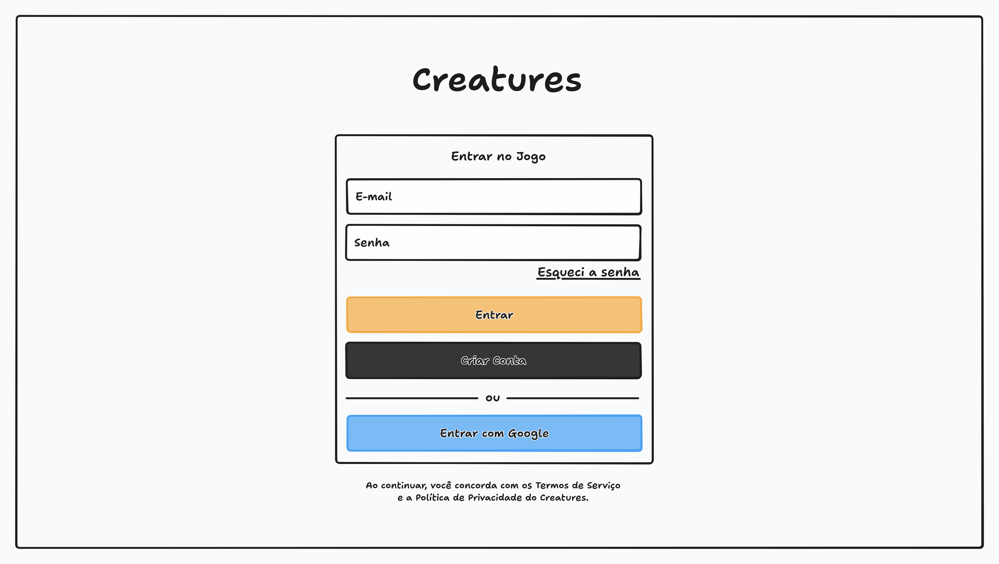
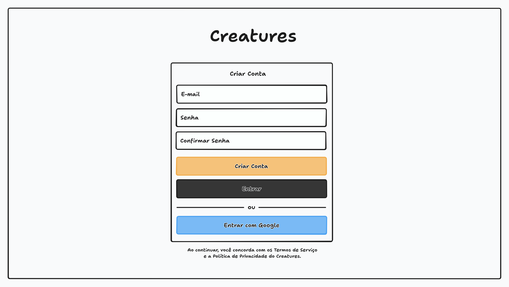
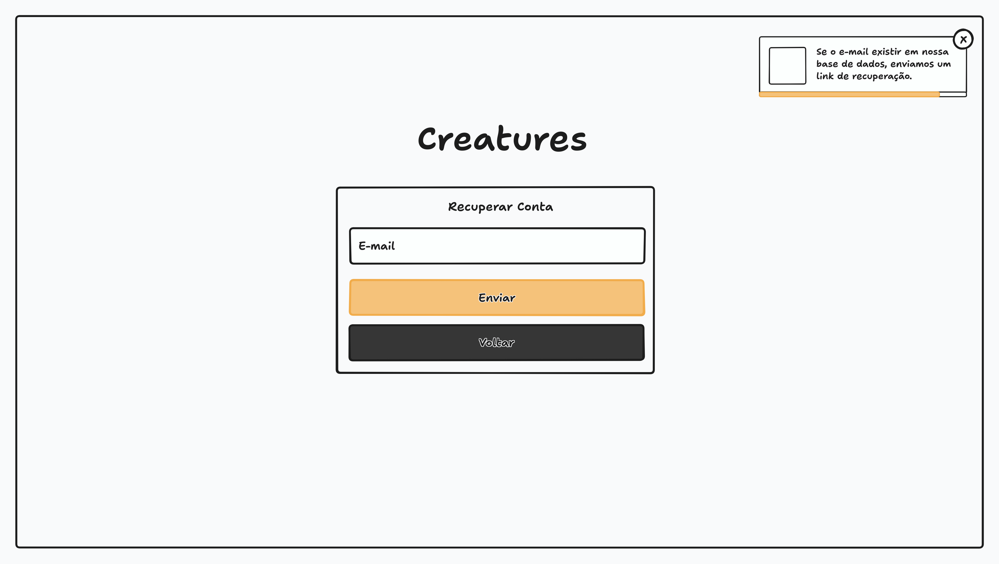
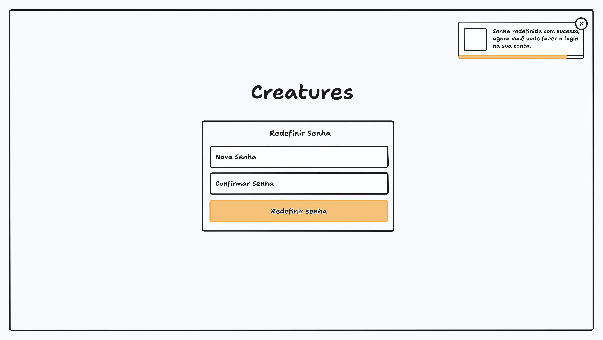
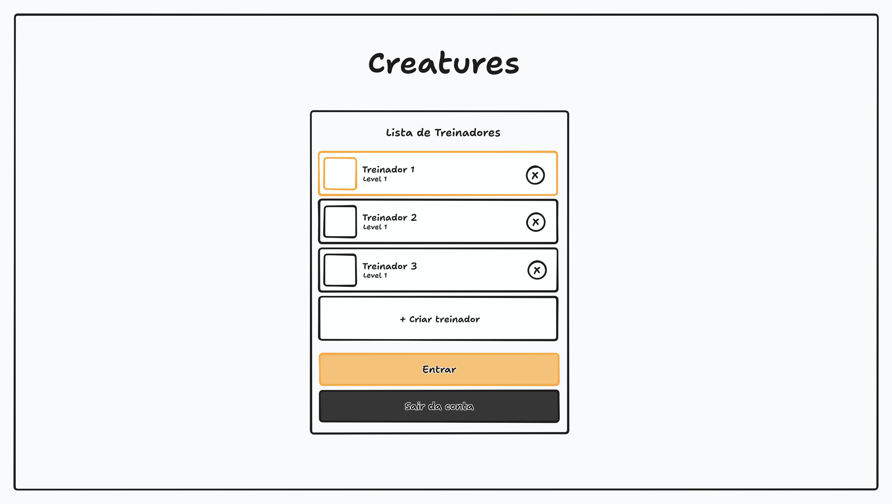
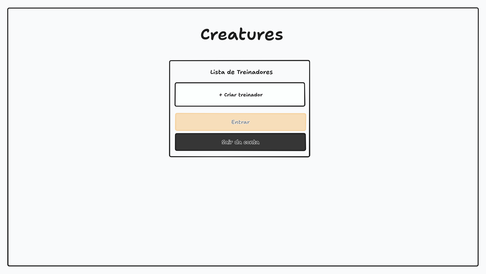
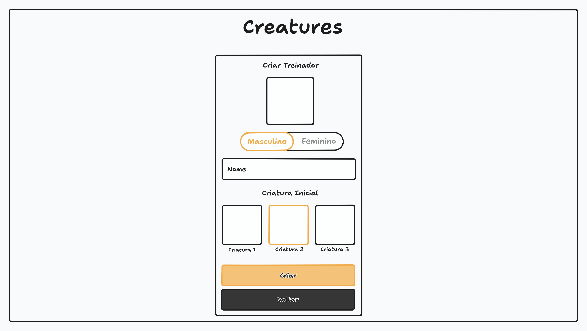

# Autenticação

Este documento cobre todo o processo de autenticação, desde a criação de contas até o acesso à conta e a administração dos treinadores.

> Um **treinador** é o personagem do jogador dentro do jogo, com nome, gênero e avatar. Cada conta pode ter no máximo 5 treinadores.

## Rotas

| Rota | Tela | Acesso |
| --- | --- | --- |
| `/signin` | [Tela de signin](#tela-de-signin) | Pública |
| `/signup` | [Tela de signup](#tela-de-signup) | Pública |
| `/forgot-password` | [Tela de esquecimento de senha](#tela-de-esquecimento-de-senha) | Pública |
| `/reset-password` | [Tela de redefinir senha](#tela-de-redefinir-senha) | Pública |
| `/terms` | [Tela de termos de serviço](#tela-de-termos-de-serviço) | Pública |
| `/privacy` | [Tela de política de privacidade](#tela-de-política-de-privacidade) | Pública |
| `/trainers` | [Tela de lista de treinadores](#tela-de-lista-de-treinadores) | Protegida |
| `/trainers/new` | [Tela de criar treinador](#tela-de-criar-treinador) | Protegida |
| `/game` | [Tela do jogo](PLAY_SCREEN.md) | Protegida |

## Escopo das Fases Alfa e Beta

Para as fases alfa e beta o cadastro é mantido simples e rápido. Os pontos abaixo são temporários e devem ser revistos antes da abertura ao público:

- Não há confirmação de e-mail no cadastro.
- Os termos de serviço e a política de privacidade são apenas placeholders.
- Ao tentar se cadastrar com um e-mail já existente, o usuário é redirecionado para a tela de signin, o que revela que o e-mail está cadastrado.

## Controle de Acesso

As telas de signin, signup, termos de serviço, política de privacidade e recuperação de senha são públicas. Todas as demais telas são protegidas e exigem uma sessão autenticada. Ao acessar uma tela protegida sem autenticação, o usuário é simplesmente redirecionado para a [tela de signin](#tela-de-signin).

Usuários já autenticados que acessarem as telas de signin, signup, esquecimento de senha ou redefinição de senha são redirecionados conforme o [controle de redirecionamento](#controle-de-redirecionamento). As telas de termos de serviço e política de privacidade continuam acessíveis para todos.

### Sessão

A sessão expira após 7 dias sem atividade. Ao expirar, o usuário é redirecionado para a [tela de signin](#tela-de-signin) no próximo acesso a uma tela protegida.

O botão "Sair da conta" fica disponível na [tela de lista de treinadores](#tela-de-lista-de-treinadores), e ao clicar encerra a sessão e redireciona o usuário para a [tela de signin](#tela-de-signin).

> A opção "Sair" também fica disponível no menu Configurações da [tela do jogo](PLAY_SCREEN.md), com o mesmo efeito: é a mesma ação em dois lugares, e não duas ações diferentes.

### Proteção Contra Tentativas Excessivas

Para evitar abuso, os seguintes limites se aplicam:

- **Signin:** após 5 tentativas falhas em 15 minutos para o mesmo e-mail ou o mesmo IP, novas tentativas são bloqueadas temporariamente com a mensagem "Muitas tentativas. Tente novamente em alguns minutos.".
- **Envio de e-mail de recuperação:** máximo de 1 envio por minuto e 5 por hora para o mesmo e-mail. Ao exceder o limite, nenhum e-mail é enviado, mas o alerta exibido ao usuário continua sendo o mesmo, para não revelar nada sobre o e-mail.

## Controle de Redirecionamento

Após qualquer autenticação bem-sucedida (por e-mail e senha ou via Google), o usuário é redirecionado conforme o estado da conta: Se a conta ainda não possui nenhum treinador, vai para a [tela de criar treinador](#tela-de-criar-treinador); Se a conta já possui treinadores, vai para a [tela de lista de treinadores](#tela-de-lista-de-treinadores).

## Regras de Senha

As regras abaixo valem para o cadastro e para a redefinição de senha:

- Mínimo de 8 e máximo de 64 caracteres, sem exigência de complexidade.
- Se a senha for menor que o mínimo, é exibida a mensagem "A senha deve ter no mínimo 8 caracteres.".
- Se a senha e a confirmação forem diferentes, é exibida a mensagem "As senhas não conferem.".

## Tela de Signin

A tela de acesso ao jogo, com o cartão "Entrar no Jogo": os campos de e-mail e senha, o link "Esqueci a senha", que leva ao fluxo de [recuperação de senha](#recuperação-de-senha), e os botões "Entrar" e "Criar Conta", que leva à [tela de signup](#tela-de-signup). Depois de um "ou", o acesso via Google. Uma vez autenticado o usuário é redirecionado conforme o [controle de redirecionamento](#controle-de-redirecionamento).

Se o e-mail ou a senha estiverem incorretos, é exibida sempre a mesma mensagem genérica "E-mail ou senha inválidos.", sem indicar qual dos dois está errado. A mesma mensagem é exibida quando o e-mail pertence a uma conta criada exclusivamente via Google, que não possui senha.

> Ao optar por autenticação via Google e o usuário ainda não for cadastrado no jogo, uma conta é criada automaticamente e o login é realizado. Caso a conta já exista, o merge da conta Google com a conta existente é feito sem criar contas duplicadas, e o usuário passa a ter acesso à conta pelos dois métodos, Google ou e-mail e senha.

> O merge só é realizado se o Google informar que o e-mail está verificado. Como o cadastro por e-mail e senha não exige confirmação de e-mail, uma conta existente pode ter sido criada por outra pessoa com o e-mail do usuário. Por isso, ao realizar o merge, a senha previamente cadastrada na conta é descartada e todas as sessões existentes são encerradas. Se quiser continuar acessando por e-mail e senha, o usuário define uma nova senha pelo fluxo de [recuperação de senha](#recuperação-de-senha).

Na parte inferior da página é exibida a seguinte frase "Ao continuar, você concorda com os [Termos de Serviço](/terms) e a [Política de Privacidade](/privacy) do Creatures.". Ambos os links redirecionam o usuário para os [termos de serviço](#tela-de-termos-de-serviço) e a [política de privacidade](#tela-de-política-de-privacidade) respectivamente.

> O mockup é ilustrativo e mostra a disposição geral, não o design final. Ele serve para conferir a estrutura da tela, não cores, tipografia ou espaçamento.

## Tela de Signup

A tela de criação de contas, com o cartão "Criar Conta": os campos e-mail, senha e confirmar senha, seguindo as [regras de senha](#regras-de-senha). Os botões são "Criar Conta" e "Entrar", que volta para a [tela de signin](#tela-de-signin). Depois de um "ou", o registro via Google.

> Ao realizar o cadastro com sucesso, o usuário é redirecionado já autenticado conforme o [controle de redirecionamento](#controle-de-redirecionamento). Se o e-mail informado já estiver cadastrado, o usuário é redirecionado para a [tela de signin](#tela-de-signin).

> Ao realizar o registro via Google em uma conta já existente, o merge é feito conforme descrito na [tela de signin](#tela-de-signin), sem criar contas duplicadas nem informações desnecessárias.

Nesse primeiro momento não é necessário confirmação de e-mail, conforme o [escopo das fases alfa e beta](#escopo-das-fases-alfa-e-beta).

> O mockup é ilustrativo e mostra a disposição geral, não o design final. Ele serve para conferir a estrutura da tela, não cores, tipografia ou espaçamento.

## Termos de Serviço e Política de Privacidade

Como a [tela de signin](#tela-de-signin) exibe um aceite formal ao continuar, ambos os documentos precisam estar escritos e publicados antes da abertura do jogo ao público, em conformidade com a LGPD.

### Tela de Termos de Serviço

Por hora uma tela com um placeholder simples, sem muita informação, que exibirá os termos de serviço quando estiverem disponíveis.

### Tela de Política de Privacidade

Assim como a [tela de termos](#tela-de-termos-de-serviço), exibe um placeholder, pois a política de privacidade ainda não foi escrita.

## Recuperação de Senha

O processo para recuperar senha é feito a partir de um "link mágico" enviado no e-mail se o mesmo existir em nossa base de dados. Contas criadas exclusivamente via Google nunca tiveram senha e, portanto, não suportam esse fluxo: o e-mail é tratado como não encontrado. Contas criadas por e-mail e senha suportam o fluxo mesmo após o merge com o Google.

### Tela de Esquecimento de Senha

A tela, com o cartão "Recuperar Conta", exibe um formulário simples com um campo e-mail e dois botões: "Enviar" e "Voltar", que volta para a [tela de signin](#tela-de-signin). Quando o e-mail é preenchido e o botão pressionado, é exibido um [alerta](INTERFACE.md#alerta) com a mensagem "Se o e-mail existir em nossa base de dados, enviamos um link de recuperação.".

> O alerta é exibido sempre que o formulário é preenchido corretamente (e-mail no formato correto, apenas o formato) e o botão pressionado, mesmo que o e-mail não exista na nossa base de dados, e isso faz parte do processo, dessa forma, não revelamos se o e-mail está ou não cadastrado.

> O mockup é ilustrativo e mostra a disposição geral, não o design final. Ele serve para conferir a estrutura da tela, não cores, tipografia ou espaçamento.

### Tela de Redefinir Senha

O acesso a essa tela é feito a partir de um link de recuperação de senha enviado no e-mail do usuário, contém um token de uso único e com expiração de 30 minutos para maior segurança. A tela exibe um formulário simples com os campos senha e confirmar senha, seguindo as [regras de senha](#regras-de-senha), seguido de um botão "Redefinir senha" que ao clicar finaliza o processo de redefinição de senha.

Ao redefinir a senha com sucesso, todas as sessões existentes da conta são encerradas e o usuário é redirecionado para a [tela de signin](#tela-de-signin), que exibe um [alerta](INTERFACE.md#alerta) com a mensagem "Senha redefinida com sucesso. Faça login para continuar.". Caso ocorra um erro, é exibido um alerta na mesma página para que o usuário tente outra vez.

> O token disponível no link deve fazer parte do formulário como um campo escondido ("hidden"), para ser enviado junto com a requisição, é o que garante a segurança e autenticidade do processo. Uma vez utilizado, o token fica inválido e não pode mais ser utilizado. Se o token estiver inválido, expirado ou já tiver sido utilizado, é exibida na mesma página o alerta "Este link de recuperação é inválido, expirou ou já foi utilizado. Solicite um novo link.", com um link para a [tela de esquecimento de senha](#tela-de-esquecimento-de-senha).

> O mockup é ilustrativo e mostra a disposição geral, não o design final. Ele serve para conferir a estrutura da tela, não cores, tipografia ou espaçamento.

## Tela de Lista de Treinadores

Tela com o cartão "Lista de Treinadores" e uma lista vertical de cards, um por treinador, com no máximo 5. Cada card exibe o avatar, o nome e o nível do treinador e, no lado direito, um botão de deletar. Com menos de 5 treinadores, um card "+ Criar treinador" aparece sempre na última posição da lista — um card só, sem slots vazios —, e clicar nele leva à [tela de criar treinador](#tela-de-criar-treinador). Sem nenhum treinador, a lista mostra apenas esse card.

Na parte de baixo da lista ficam dois botões: "Entrar", único para qualquer treinador e desabilitado até que um seja selecionado, e "Sair da conta", que encerra a sessão conforme a [sessão](#sessão).

Ao clicar em um card, o treinador é selecionado e o card ganha um destaque visual na borda. Clicar novamente no card selecionado remove a seleção, e o botão "Entrar" volta a ficar desabilitado.

Com um treinador selecionado, ao clicar em "Entrar" o usuário é redirecionado para a [tela do jogo](PLAY_SCREEN.md) onde pode começar a jogar.

> Ao clicar no botão de deletar, um diálogo de confirmação deve ser exibido para o usuário, evitando exclusões errôneas. A confirmação deve deixar explícito que a remoção é definitiva: itens, criaturas e todo o progresso do treinador são perdidos.

> Ao remover um treinador, todos os dados vinculados a ele, incluindo itens e criaturas, são apagados do banco de dados, como se o treinador nunca tivesse sido criado. A conta em si continua existindo. Se o último treinador for removido, o usuário permanece na tela com apenas o card de criar, sem redirecionamento automático.

> O mockup é ilustrativo e mostra a disposição geral, não o design final. Ele serve para conferir a estrutura da tela, não cores, tipografia ou espaçamento.

## Tela de Criar Treinador

Tela com o cartão "Criar Treinador", no mesmo formato dos outros formulários de autenticação. De cima para baixo ela exibe: o avatar do treinador, que muda de acordo com o gênero selecionado; a seleção de gênero, em uma toggle entre Masculino e Feminino, sendo Masculino a opção selecionada por padrão; e o campo de nome, com as mesmas validações.

A tela tem ainda a seção "Criatura Inicial", em que o jogador escolhe uma entre as criaturas iniciais disponíveis. A escolha é obrigatória: sem criatura selecionada, ou com o nome inválido, o botão "Criar" fica desabilitado. As criaturas iniciais vêm do banco de dados — são as espécies marcadas como iniciais —, então mudar as opções da tela não exige deploy, conforme as [Criaturas Iniciais](CREATURES.md#criaturas-iniciais).

Na parte inferior ficam dois botões, "Criar" e "Voltar", sendo que "Voltar" está sempre habilitado.

> O nome deve ter entre 3 e 15 caracteres e conter apenas letras (com ou sem acento), números, espaços, traços e underscores, nada mais do que isso. Espaços no início ou no fim são removidos, e espaços consecutivos não são permitidos. A validação deve apontar o erro de caractere com a mensagem "Apenas caracteres simples, espaços, traços e underscores são permitidos." e o erro de tamanho com a mensagem "O nome deve ter entre 3 e 15 caracteres.".

> O nome é único em todo o jogo, e a comparação ignora diferenças de maiúsculas, minúsculas e acentos, ou seja, "Ana", "ana" e "Aná" são considerados o mesmo nome.

> Como o nome pode ser ocupado por outro jogador entre o "blur" e o clique em "Criar", o servidor deve validar o nome novamente no momento da criação. Se o nome não estiver mais disponível, o treinador não é criado, o usuário permanece na tela e é exibida a mensagem "Nome indisponível".

Ao clicar em criar, o treinador é criado e o usuário é redirecionado para a [tela de lista de treinadores](#tela-de-lista-de-treinadores).

Cada conta pode ter no máximo 5 treinadores, limite que também deve ser imposto pelo servidor. Se a conta já tiver 5 treinadores, ao acessar essa tela o usuário é redirecionado para a [tela de lista de treinadores](#tela-de-lista-de-treinadores), que exibe um [alerta](INTERFACE.md#alerta) com a mensagem "Você atingiu o limite de 5 treinadores.".

Ao clicar em voltar, o usuário é redirecionado de volta para a [tela de lista de treinadores](#tela-de-lista-de-treinadores).

> O mockup é ilustrativo e mostra a disposição geral, não o design final. Ele serve para conferir a estrutura da tela, não cores, tipografia ou espaçamento.
