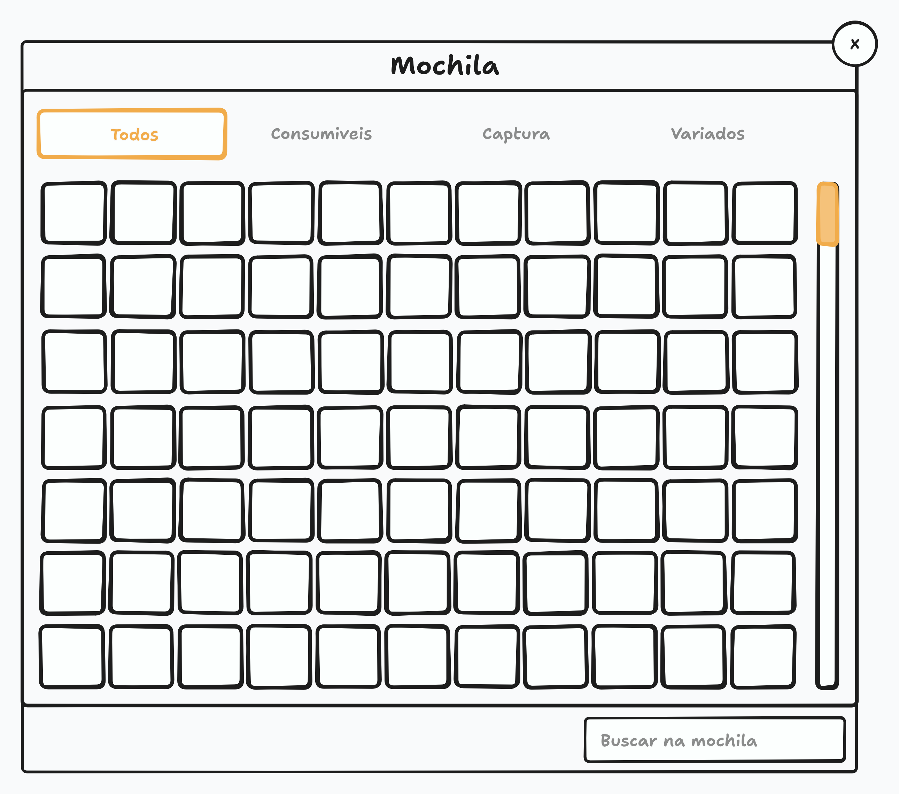
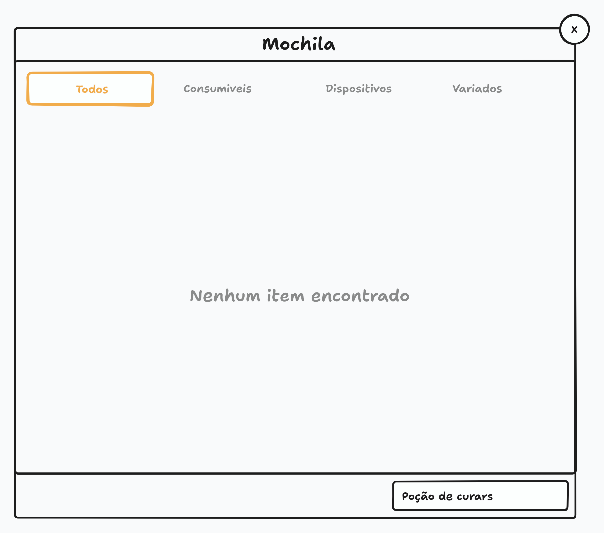

# Mochila

Este documento cobre o modal da mochila, onde o jogador vê todos os itens que o treinador possui, comprados, ganhos caçando ou obtidos de qualquer outra forma.

> Este documento cobre **o modal dos itens**. O que o treinador pode ter e como os itens são obtidos ainda será definido e documentado em [Treinador](TRAINER.md) e [Caçada](HUNT.md). A tela de onde a mochila é aberta é a [Tela do Jogo](PLAY_SCREEN.md).

## Visão Geral

A mochila é um modal aberto pelo primeiro botão do menu da esquerda da [toolbar](PLAY_SCREEN.md#menu-da-esquerda) da tela do jogo, onde o jogador vê a lista de todos os itens do treinador. Por enquanto o jogador só consulta os itens: nenhuma interação com eles existe ainda, e elas serão definidas no futuro.

> A mochila é só de consulta, e vender item acontece fora dela: a venda é uma aba da [loja](STORE.md).

O modal segue o mesmo layout do [modal de locais de caça](HUNT_AREA_SELECT.md): título no topo, conteúdo no corpo e rodapé com a busca. O que ele tem de diferente são os filtros por categoria e a grade de slots de itens no lugar da lista de áreas.

> O modal não pausa o jogo. A simulação continua rodando com ele aberto, conforme a regra da [tela do jogo](PLAY_SCREEN.md): nenhum elemento da tela, inclusive os modais abertos a partir dela, pausa ou bloqueia o jogo.

## Mockup

> O mockup é ilustrativo e mostra a disposição geral, não o design final. Ele serve para conferir a estrutura da tela, não cores, tipografia ou espaçamento.

O mockup mostra o modal com o título **Mochila** no topo e o botão de fechar no canto superior direito. Abaixo do título ficam os filtros rápidos em abas, com **Todos** ativo, e abaixo deles a grade de slots vazios, com a barra de rolagem sempre visível na lateral direita. O rodapé tem apenas o campo de busca, à direita.

O segundo mockup mostra a busca sem resultado: a grade dá lugar à mensagem **Nenhum item encontrado**, centralizada no corpo do modal, com o termo pesquisado no campo de busca do rodapé.

## Estrutura do Modal

### Título e Fechamento

O modal tem o título **Mochila** no topo.

No canto superior direito há um botão circular com o ícone de fechar, que fecha o modal ao ser clicado, como no [modal de locais de caça](HUNT_AREA_SELECT.md#título-e-fechamento).

> Fechar o modal não altera nada. O jogador não fica preso na consulta, e fechar é só uma forma de voltar ao jogo.

### Filtros Rápidos

No topo do conteúdo do modal, acima dos slots de itens, ficam os filtros rápidos, exibidos como abas: **Todos**, **Consumíveis**, **Dispositivos** e **Variados**. O filtro ativo fica destacado, e clicar em outro filtro troca a exibição.

- **Todos:** exibe todos os itens do treinador, sem olhar categoria.
- **Consumíveis:** exibe os itens de uso, como as poções de cura.
- **Dispositivos:** exibe os dispositivos usados para capturar criaturas.
- **Variados:** exibe os itens que não se encaixam nas outras categorias, como os drops de criaturas.

> A categoria é definida no próprio item, e é ela que decide em qual filtro o item aparece. Um item sem categoria alguma aparece apenas no filtro Todos, e Variados é a categoria que fica com o que sobra: o drop de criatura e o item que ainda não tem lugar nas outras três.

### Slots de Itens

Abaixo dos filtros ficam os slots de itens, em uma grade que ocupa o corpo do modal. A grade não tem número máximo de slots e não existe limite de itens: ela cresce com a quantidade de itens do treinador, dentro do [tamanho fixo](INTERFACE.md#tamanho-fixo) do modal.

A grade sempre exibe fileiras completas: a última fileira é completada com slots vazios, então um jogador com itens para uma fileira e meia vê a segunda fileira completa, com a metade vazia. A grade **não cria fileira nova**: o que sobra da área visível é o fundo do painel, e não mais fileiras de slots. Um treinador sem item nenhum vê uma fileira inteira de slots vazios.

O número de colunas não é regra: ele depende do tamanho do modal e será validado no design da interface. O que a grade garante é a forma — fileira completa, última fileira preenchida —, e não uma quantidade fixa de colunas.

> A regra das fileiras completas existe para o jogador entender que ali existe um slot, e não um espaço sobrando. Com ela, nenhum quadrado branco solto aparece na tela.

> A grade não inventa fileira: uma criatura guardada mostra uma fileira, e não a área inteira coberta de slots vazios. A lista cresce com a quantidade de itens, e o rodapé com a busca continua no mesmo lugar.

Uma barra de rolagem fica fixa na lateral direita da área da grade, sempre visível, mesmo quando o conteúdo cabe na tela.

> A [barra de rolagem](INTERFACE.md#barra-de-rolagem) sempre visível vale para toda área rolável do jogo.

### Busca

No rodapé do modal, à direita, há um campo de busca, como no [modal de locais de caça](HUNT_AREA_SELECT.md#busca), que filtra os itens pelo **nome do item**. O campo tem o placeholder **Buscar na mochila**.

A busca ignora acentos e maiúsculas: "pocao de cura" encontra "Poção de Cura", e o jogador não depende de acertar a acentuação.

A busca sempre vale sobre todos os itens: ao usar o campo de busca, o filtro ativo volta para **Todos**.

> A busca ignora o filtro ativo para o jogador não ficar preso em uma aba sem resultado. Se ele está em Variados, pesquisa e não acha, o item pode estar em outra categoria, e a busca precisa encontrá-lo de qualquer forma.

Quando a busca não encontra nenhum item, o corpo do modal exibe a mensagem **Nenhum item encontrado**, centralizada, no lugar da grade de slots. Com a mensagem no lugar da grade, a área não tem rolagem.

> A mensagem no lugar da grade segue o [modal de locais de caça](HUNT_AREA_SELECT.md#busca): o jogador entende que a busca rodou e não achou nada, em vez de ver uma grade vazia e ficar na dúvida.

### Popup do Item

Ao passar o cursor sobre um item, é exibido um popup com informações dele, seguindo o comportamento padrão de [popup](INTERFACE.md#popup) da interface. Por enquanto o popup exibe apenas o **nome do item**, e exibirá mais informações no futuro.

## Comportamento

O modal não pausa o jogo. A simulação continua rodando com ele aberto.

> Isso não é uma escolha do modal e sim uma regra da [tela do jogo](PLAY_SCREEN.md): nenhum elemento da tela, inclusive os modais abertos a partir dela, pausa ou bloqueia o jogo.

Se a conexão com o servidor cai enquanto o modal está aberto, o modal é fechado junto com o restante da tela.

> Isso acontece por consequência da regra de [conexão da tela do jogo](PLAY_SCREEN.md#estados-da-tela): ao perder a conexão, o cliente sai da tela do jogo e exibe a tela de conexão perdida. Ao restabelecer, os componentes da tela são montados de novo, e o modal abre fechado. Não é preciso nenhum tratamento específico para esse caso.

## Escopo das Fases Alfa e Beta

Os pontos abaixo ainda estão em aberto ou são provisórios nesta fase e devem ser revistos conforme o jogo evolui:

- O jogador só consulta os itens. As interações com os itens, como usar, equipar e descartar, serão definidas no futuro.
- O popup exibe apenas o nome do item. Mais informações serão adicionadas depois.
- O rodapé tem apenas o campo de busca. A paginação ainda não existe.
- A categorização é fixa nos quatro filtros definidos e será revista quando existirem mais tipos de item.
