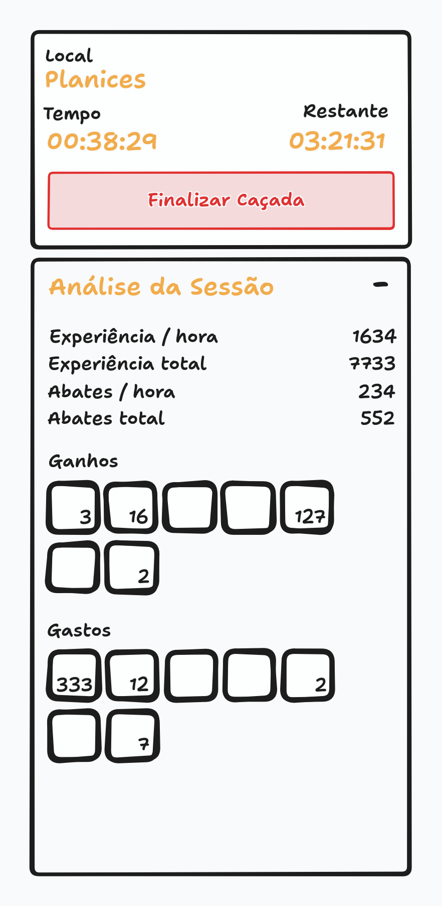
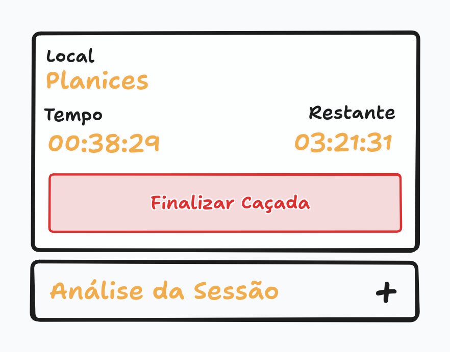

# Analisador de Caçada

Este documento cobre os painéis da caçada, no canto superior esquerdo da tela durante a caçada: o painel da sessão, com o local, os tempos e a ação de finalizar, e a análise da sessão, com os números da caçada.

> Este documento cobre **os painéis da caçada**. A atividade da caçada em si está em [Caçada](HUNT.md), e a tela de onde os painéis fazem parte é a [Tela do Jogo](PLAY_SCREEN.md).

## Visão Geral

Os painéis ficam no canto superior esquerdo da [tela do jogo](PLAY_SCREEN.md#painéis-da-caçada), logo abaixo da toolbar, e existem só durante a caçada. Eles são flutuantes: ficam por cima do canvas, sem empurrá-lo, como a barra de habilidades.

São dois painéis, um sobre o outro:

- **Painel da sessão:** mostra o local da caçada, o tempo decorrido e o tempo restante, e tem o botão **Finalizar Caçada**, que encerra a caçada.
- **Análise da sessão:** mostra os números da caçada — experiência e abates, por hora e no total, além dos itens ganhos e gastos. Ela pode ser recolhida em uma única linha e expandida de novo.

> O que cada número da análise significa e como ele é calculado ainda será definido. Este documento começa só com a estrutura dos painéis.

## Mockup

> O mockup é ilustrativo e mostra a disposição geral, não o design final. Ele serve para conferir a estrutura da tela, não cores, tipografia ou espaçamento.

O mockup mostra os dois painéis abertos: o da sessão, com o local (Planices), o tempo decorrido, o tempo restante e o botão Finalizar Caçada, e o de análise, com experiência e abates por hora e no total, ganhos e gastos em itens.

O segundo mockup mostra a análise recolhida: ela fica em uma única linha com o título **Análise da Sessão** e um **+**, que a expande de novo, enquanto o painel da sessão segue visível.

## Estrutura

### Painel da Sessão

O painel da sessão mostra três informações sobre a caçada em andamento:

- **Local:** o nome da área onde o treinador está caçando.
- **Tempo:** o tempo decorrido desde o início da caçada.
- **Restante:** o tempo restante da [sessão offline](TRAINER.md#sessão-offline) da conta.

No rodapé do painel fica o botão **Finalizar Caçada**, que encerra a caçada do jogador.

### Análise da Sessão

A análise mostra os números da caçada:

- **Experiência / hora** e **experiência total:** a experiência obtida na sessão, no ritmo por hora e no total.
- **Abates / hora** e **abates totais:** as criaturas selvagens derrotadas na sessão, no ritmo por hora e no total.
- **Ganhos:** os itens obtidos na sessão, cada slot mostrando a quantidade.
- **Gastos:** os itens gastos na sessão, cada slot mostrando a quantidade.

A análise pode ser recolhida em uma única linha, com o título e um controle para expandir de novo.

> O que cada número significa exatamente e como ele é calculado ainda será definido. As contas da análise serão documentadas quando forem explicadas.

## Comportamento

Os painéis são flutuantes e existem só durante a caçada: eles aparecem quando a caçada começa e somem quando ela acaba.

> Os painéis seguem a regra da [tela do jogo](PLAY_SCREEN.md): nenhum elemento flutuando sobre o canvas o empurra ou o bloqueia, e o jogo continua rodando com eles abertos.

Clicar em **Finalizar Caçada** encerra a caçada pelo jogador, conforme as regras de [fim da caçada](HUNT.md#fim-da-caçada).

## Escopo das Fases Alfa e Beta

Os pontos abaixo ainda estão em aberto ou são provisórios nesta fase e devem ser revistos conforme o jogo evolui:

- A análise existe apenas com os números do mockup. O cálculo de cada um ainda será definido.

## Pendências

Os pontos abaixo ainda não foram decididos:

- O que cada número da análise significa e como é calculado.
- O que acontece quando o jogador finaliza a caçada, incluindo o que ocorre com os itens obtidos.
- Se o botão Finalizar Caçada continua visível com a análise recolhida.
