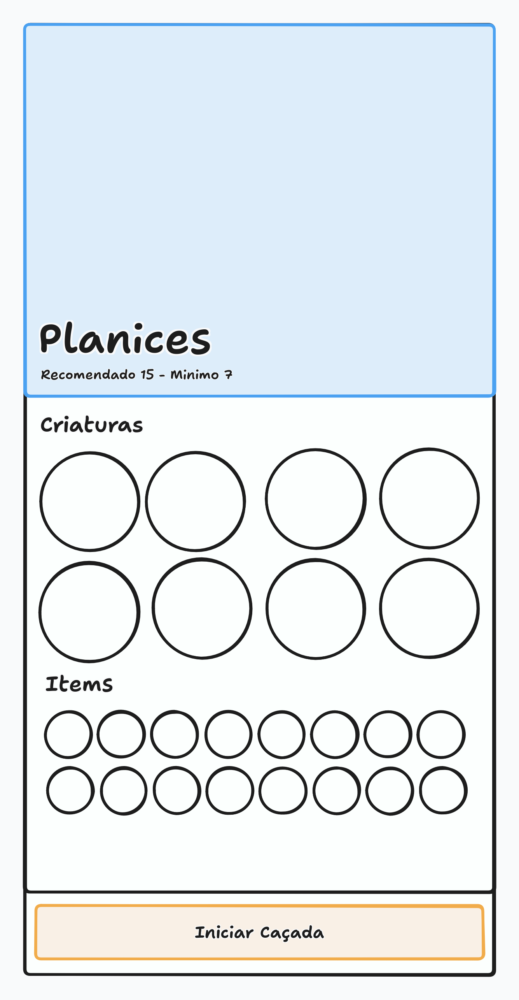

# Detalhes da Área de Caça

Este documento cobre o drawer que abre ao selecionar uma área de caça, mostrando as informações da área e o botão de iniciar a caçada.

> Este documento cobre **o drawer de uma área**. A escolha da área em si está em [Seleção de Área de Caça](HUNT_AREA_SELECT.md), e o que acontece depois de entrar na área está em [Caçada](HUNT.md).

## Visão Geral

Selecionar uma área no [modal de seleção](HUNT_AREA_SELECT.md) abre um drawer à direita da tela, com as informações da área escolhida e o botão de iniciar a caçada.

> O drawer abre por cima do modal, e não no lugar dele, para que o jogador possa fechá-lo e escolher outra área sem ter que abrir o modal de novo. A seleção de uma área nunca obriga a recomeçar.

O drawer não pausa o jogo. A simulação continua rodando com ele aberto.

> Isso não é uma escolha do drawer e sim uma regra da [tela do jogo](PLAY_SCREEN.md): nenhum elemento da tela, inclusive os modais e drawers abertos a partir dela, pausa ou bloqueia o jogo.

## Mockup

> O mockup é ilustrativo e mostra a disposição geral, não o design final. Ele serve para conferir a estrutura da tela, não cores, tipografia ou espaçamento.

## Estrutura

O drawer é dividido em três partes:

1. **Cabeçalho**, com a imagem da área, o nome e os níveis.
2. **Body**, com as criaturas e os itens da área.
3. **Rodapé**, com o botão de iniciar caçada.

O cabeçalho e o rodapé são **fixos**: eles não se movem quando o jogador rola a tela.

O **body é a única parte que rola**. Se a quantidade de criaturas e de itens for grande o suficiente para não caber, o scroll acontece no body, e o cabeçalho e o rodapé continuam visíveis.

> O cabeçalho e o rodapé ficam fixos porque são as duas coisas que importam na decisão: o que é a área e o que o jogador vai escolher. Se qualquer um deles saísse da tela, o jogador teria que rolar para cima para confirmar onde está e para baixo para achar o botão de entrar.

## Cabeçalho

O cabeçalho exibe uma imagem ilustrativa da área. Para as fases alfa e beta, a imagem é um placeholder de cor sólida.

Sobre a imagem são exibidos o **nome da área**, o **nível recomendado** e o **nível mínimo**, na mesma linha.

> A imagem é ilustrativa e não mostra o mapa nem a posição das criaturas. Ela existe para o jogador reconhecer a área de imediato, e o placeholder de cor sólida é suficiente enquanto os assets não existem.

Os níveis funcionam como no [card do modal](HUNT_AREA_SELECT.md#nível-recomendado-e-nível-mínimo).

## Body

O body tem duas seções, **Criaturas** e **Itens**.

### Criaturas

A seção lista **todas** as criaturas da área, sem exceção.

> A lista aqui é completa de propósito. No [card do modal](HUNT_AREA_SELECT.md#criaturas-da-área) as criaturas são cortadas em 7 posições, com um indicador de que existem mais. O drawer é onde o jogador descobre exatamente o que vai encontrar no local.

Cada criatura é exibida em um círculo com o avatar dela. Ao passar o cursor sobre o círculo, é exibido um tooltip com o **nome da criatura**.

> O tooltip mostra apenas o nome da criatura nesta fase. Ele existe para o jogador conseguir identificar as criaturas, e será evoluído com mais informações depois.

### Itens

A seção lista **todos** os itens que podem ser obtidos na área, sendo o resultado da união dos itens que cada criatura da área pode deixar.

Se duas criaturas dropam o mesmo item, ele aparece uma única vez na lista.

> A lista de itens é o conjunto de tudo o que pode sair da área, e não o de uma criatura específica. Por exemplo, se a área tem a criatura A e a criatura B, e A deixa os itens AA, BB e CC, enquanto B deixa BB, DD e EE, a seção mostra AA, BB, CC, DD e EE. O item BB aparece uma vez só.

> Cada item pertence à área, e não a uma criatura. Isso muda o que o jogador espera: ele não procura um item de uma criatura específica, e sim o que a área inteira pode render.

Cada item é exibido em um círculo com o ícone dele. Ao passar o cursor sobre o círculo, é exibido um tooltip com o **nome do item**.

> O comportamento é o mesmo das criaturas, e o tooltip mostra apenas o nome do item nesta fase.

## Rodapé

O rodapé tem o botão **Iniciar caçada**, com a largura de 100% do drawer.

> O botão ocupa toda a largura porque é a única ação do drawer. Ele é o que o jogador veio fazer aqui, e não deveria ter competes com nada.

### Área Bloqueada

Quando o treinador está abaixo do nível mínimo da área, o botão fica desabilitado e mostra o motivo: **Nível mínimo não alcançado**.

> O bloqueio acontece no drawer, e não no card, porque é no drawer que a caçada é iniciada. O card bloqueado é clicável justamente para que o jogador chegue aqui e veja o motivo.

> O botão mostra o motivo em vez de simplesmente estar apagado, para que o jogador entenda que a área não foi descartada por estar indisponível, e sim porque o treinador ainda não tem o nível necessário.

## Iniciar Caçada

Ao clicar em **Iniciar caçada**, começa uma contagem de **5 segundos**, exibida no próprio rótulo do botão, que fica bloqueado durante a espera.

A contagem vai de **Iniciando caçada em 5** até **Iniciando caçada em 1**.

> A contagem acontece na mesma tela, com o drawer e o modal abertos. O jogador permanece vendo as duas camadas enquanto espera, em vez de ser levado a outra tela antes de entrar na área.

> A espera vale para qualquer início de caçada, sem exceção: tanto quando o jogador está em uma cidade ou em outra área segura, quanto quando está no meio de outra caçada. Ela não é uma troca de área, é o tempo de entrada em um local de caça.

> A demora existe para que a entrada não seja imediata. Um jogador que entra e sai de uma área em segundos consegue escapar de uma situação de forma imprevisível, como uma criatura desmaiando.

Quando a contagem chega a zero, o drawer é fechado, o [modal de seleção](HUNT_AREA_SELECT.md) é fechado se ainda estiver aberto, e a caçada é iniciada.

> Os dois fechamentos são para que o jogador entre na caçada sem nenhuma camada de interface por cima. O modal permanece aberto atrás do drawer desde a seleção da área, e sem fechá-lo a tela do jogo ficaria com as duas camadas visíveis depois da entrada.

> O que o jogador vê durante o carregamento da área não faz parte deste documento. Ele está em [Caçada](HUNT.md).

A regra da espera de 5 segundos está descrita em [Iniciar Caçada](HUNT_AREA_SELECT.md#iniciar-caçada).

### Área Atual

Iniciar uma caçada na área em que o treinador já está é permitido: a caçada é reiniciada nela, com a mesma espera de 5 segundos, e sem qualquer bloqueio ou aviso.

> Não existe tratamento especial para este caso. Reiniciar na mesma área segue exatamente o mesmo fluxo de iniciar em outra, porque para o jogador é a mesma ação: sair de onde está e entrar em um local de caça.

## Responsividade

O drawer se adapta a telas menores escalando os elementos ao tamanho da tela, com um tamanho mínimo e um tamanho máximo.

> A adaptação da interface no projeto segue essa regra, em vez de ter uma versão separada para celular. O conteúdo é o mesmo, e o que muda é o tamanho das coisas dentro de um limite.

## Conexão

Se a conexão com o servidor cai com o drawer aberto, o drawer é fechado junto com a tela.

> Isso acontece por consequência da regra de [conexão da tela do jogo](PLAY_SCREEN.md#estados-da-tela): ao perder a conexão, o cliente sai da tela do jogo e exibe um dos estados de conexão. Ao restabelecer, os componentes da tela são montados de novo, e o modal e o drawer abrem fechados. Não é preciso nenhum tratamento específico para esse caso.

## Escopo das Fases Alfa e Beta

Os pontos abaixo ainda estão em aberto ou são provisórios nesta fase e devem ser revistos conforme o jogo evolui:

- A imagem da área é um placeholder de cor sólida.
- O tooltip das criaturas mostra apenas o nome.
- O tooltip dos itens mostra apenas o nome.

## Pendências

Os pontos abaixo ainda não foram decididos:

- Os valores de tamanho mínimo e máximo da escala da interface.