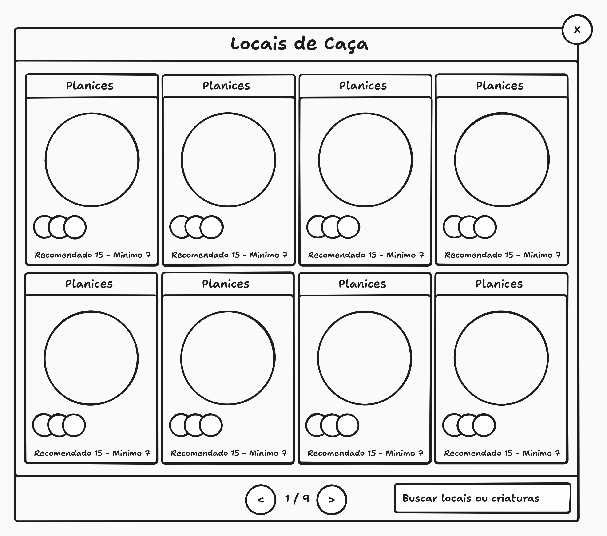

# Seleção de Área de Caça

Este documento cobre o modal que o jogador abre para escolher em que área vai caçar, o passo que acontece antes de entrar na caçada.

> Este documento cobre **a tela de escolha**. O que acontece depois que o jogador entra na área está em [Caçada](HUNT.md), e a cidade de onde ele sai está em [Áreas Seguras](SAFE_AREAS.md). Os detalhes de uma área selecionada estão em [Detalhes da Área de Caça](HUNT_AREA_DETAILS.md).

## Visão Geral

A seleção de área de caça é um modal aberto pelo botão **Áreas de Caça**, no menu central da [tela do jogo](PLAY_SCREEN.md).

O modal lista as áreas onde o treinador pode caçar, com os dados necessários para o jogador escolher. Selecionar uma área abre os [detalhes da área](HUNT_AREA_DETAILS.md), de onde a caçada é iniciada.

> O botão de Áreas de Caça é, junto com o de Configurações, um dos poucos da toolbar que não é placeholder. Os demais ainda não têm função definida, conforme o [escopo das fases alfa e beta](#escopo-das-fases-alfa-e-beta).

## Mockup

> O mockup é ilustrativo e mostra a disposição geral, não o design final. Ele serve para conferir a estrutura da tela, não cores, tipografia ou espaçamento.

O mockup mostra um modal com o título centralizado no topo, o botão de fechar no canto superior direito, uma grade de cards de área ocupando o corpo do modal, e um rodapé com a paginação centralizada e o campo de busca à direita.

## Estrutura do Modal

### Título e Fechamento

O modal tem o título **Locais de Caça** no topo.

No canto superior direito há um botão circular com o ícone de fechar, que fecha o modal ao ser clicado.

> O botão de fechar está no canto superior direito e não no rodapé, para que ele não concorra com a paginação e a busca, que também ficam no rodapé.

O jogador pode fechar o modal sem escolher nada, e o jogo segue como estava.

> Fechar o modal não altera nada. O jogador não fica preso na escolha, e fechar sem selecionar é uma forma de voltar do modal sem iniciar caçada nenhuma.

### Lista de Áreas

O corpo do modal exibe uma lista de cards, um para cada área de caça.

A ordem das áreas é definida pelo servidor, do **menor nível para o maior**.

> A ordem vem do servidor porque o cliente não decide nada sobre o jogo, como vale para o conteúdo da lista. Ordenar do menor para o maior coloca as áreas acessíveis para o jogador atual no começo da lista.

### Card de Área

Cada card representa uma área de caça e é dividido em quatro partes, de cima para baixo:

1. **Título da área**, no topo do card.
2. **Criatura principal da área**, exibida em tamanho grande.
3. **Criaturas da área**, exibidas em uma sequência de círculos sobrepostos uns aos outros.
4. **Nível recomendado e nível mínimo**, no rodapé do card, na mesma linha.

#### Criaturas da Área

Toda área tem uma ou mais criaturas, e sempre existe uma **criatura principal**, que é a exibida em tamanho grande no card. As demais criaturas da área aparecem na sequência de círculos sobrepostos.

> Os círculos se sobrepõem de propósito. Uma área pode ter várias criaturas, e a lista inteira não pode ocupar o espaço do card. A sobreposição mostra que existem outras criaturas sem que cada uma precise de espaço próprio.

> A criatura principal não é a mais forte nem a mais rara da área. Ela é a que melhor representa o que se encontra lá, e é definida pelo design de cada área.

A lista completa de criaturas da área está no drawer de [detalhes da área](HUNT_AREA_DETAILS.md), e não no card.

A maioria das áreas tem cerca de 4 criaturas. Áreas com 5 ou 6 são raras.

A sequência de círculos mostra até **7 criaturas**. Quando a área tem mais que isso, são exibidas as 6 primeiras e a última posição da sequência é ocupada por um indicador **+**, sinalizando que existem mais.

> O card mostra o começo da lista e nunca a inteira. É o drawer que mostra tudo o que tem no local, sem exceção.

#### Nível Recomendado e Nível Mínimo

O rodapé do card mostra o nível recomendado e o nível mínimo da área, na mesma linha.

O **nível recomendado** é uma sugestão e não impede o jogador de caçar na área.

O **nível mínimo** é obrigatório: um treinador abaixo dele não pode caçar naquela área.

> A distinção é deliberada. O nível recomendado é um conselho para o jogador ter uma caçada satisfatória, e ignorá-lo é permitido. O nível mínimo é uma regra do servidor, e um treinador abaixo dele é impedido de entrar na área.

> Os dois níveis são independentes e não precisam se encontrar. Uma área pode recomendar um nível abaixo do seu mínimo, se o design quiser um desafio mais exigente do que o recomendado.

#### Área Bloqueada

Quando o treinador está abaixo do nível mínimo da área, o card é exibido com **menor opacidade**, indicando que a área está bloqueada.

O card bloqueado continua sendo clicável.

> O card não some e não fica sem ação. Ele continua acessível para o jogador ver o que a área tem, e é no drawer que o bloqueio é aplicado de fato, com o botão de iniciar caçada desabilitado. Bloquear no card esconderia informação que o jogador talvez queira usar para planejar o futuro.

O bloqueio é aplicado pelo servidor, e não pelo cliente.

> Cabe ao servidor decidir se uma caçada é permitida. O cliente exibe a condição que o servidor informou, mas não pode permitir uma caçada que o servidor vai recusar.

### Busca

No rodapé do modal, à direita, há um campo de busca.

A busca filtra as áreas pelo **nome da área** ou pelo **nome de uma criatura** que a área tem.

> A busca por criatura existe para o jogador chegar na área pelo que vai encontrar nela, e não só pelo nome do lugar. Quem está atrás de um Voador procura pelo Voador, e não por um nome de área que talvez nem saiba.

A busca ignora acentos e maiúsculas.

> O texto pesquisado é normalizado antes da comparação: os acentos são removidos e as letras maiúsculas e minúsculas passam a ser equivalentes. Isso faz com que "monsTRINHO" encontre "Monstrinho", e que a busca não dependa de o jogador acertar a acentuação.

Quando a busca não encontra nenhuma área, o corpo do modal exibe a mensagem **Nenhum local de caça encontrado**, no lugar da lista.

A paginação é reiniciada quando a busca muda.

> Ao buscar, o jogador começa da primeira página. Sem isso, ele poderia buscar algo e não encontrar o resultado, porque o resultado estaria em uma página que ele não está vendo.

### Paginação

No rodapé do modal, ao centro, há a paginação da lista de áreas.

> A paginação fica centralizada e a busca fica à direita porque são funções diferentes: uma navega entre as áreas, a outra filtra. O rodapé é dividido entre as duas.

## Seleção da Área

Selecionar uma área abre o drawer de [detalhes da área](HUNT_AREA_DETAILS.md), por cima do modal, mostrando mais informações sobre a área e o botão de iniciar caçada.

Fechar o drawer devolve o jogador ao modal de seleção, no ponto em que ele estava.

> O drawer abre por cima do modal em vez de substituí-lo, para que o jogador possa fechar o drawer e escolher outra área sem ter que abrir o modal de novo. A seleção de uma área nunca obriga a recomeçar.

A seleção não inicia a caçada diretamente. Ela abre os detalhes, para que o jogador veja o que está escolhendo antes de entrar.

### Área Bloqueada

No drawer de uma área bloqueada, o botão de iniciar caçada fica desabilitado e mostra o motivo: **Nível mínimo não alcançado**.

> O bloqueio acontece no drawer, e não no card, porque é no drawer que a caçada é iniciada. O card bloqueado é clicável justamente para que o jogador chegue aqui e veja o motivo.

> O botão mostra o motivo em vez de simplesmente estar apagado, para que o jogador entenda que a área não foi descartada por estar indisponível, e sim porque o treinador ainda não tem o nível necessário.

### Iniciar Caçada

Ao clicar em **Iniciar caçada**, o jogador leva **5 segundos** para entrar na área.

Durante a espera, o botão fica desabilitado e mostra a contagem regressiva, de **Iniciando caçada em 5** até **Iniciando caçada em 1**.

> A espera vale para qualquer início de caçada, sem exceção: tanto quando o jogador está em uma cidade ou em outra área segura, quanto quando está no meio de outra caçada. Ela não é uma troca de área, é o tempo de entrada em um local de caça.

> A contagem fica no próprio botão, que já é o lugar onde o jogador está olhando para decidir se entra. Uma tela de espera separada esconderia a ação que o jogador acabou de tomar.

> A demora existe para que a entrada não seja imediata. Um jogador que entra e sai de uma área em segundos consegue escapar de uma situação de forma imprevisível, como uma criatura desmaiando.

O que acontece durante esses 5 segundos e o que o jogador vê está em [Caçada](HUNT.md).

### Trocar de Área

O jogador que está caçando pode abrir este mesmo modal e escolher outra área, seguindo o mesmo fluxo: selecionar o card e depois iniciar a caçada no drawer.

A troca passa pela mesma espera de 5 segundos de [iniciar caçada](#iniciar-caçada).

## Comportamento

O modal não pausa o jogo. A simulação continua rodando com ele aberto.

> Isso não é uma escolha do modal e sim uma regra da [tela do jogo](PLAY_SCREEN.md): nenhum elemento da tela, inclusive os modais abertos a partir dela, pausa ou bloqueia o jogo. O que o jogador pode fazer depende do que está acontecendo no jogo, e não do que está aberto na tela.

Se a conexão com o servidor cai enquanto o modal está aberto, o modal é fechado junto com o restante da tela.

> Isso acontece por consequência da regra de [conexão da tela do jogo](PLAY_SCREEN.md#estados-da-tela): ao perder a conexão, o cliente sai da tela do jogo e passa a exibir um dos estados de conexão. Ao restabelecer, os componentes da tela são montados de novo, e o modal e o drawer abrem fechados. Não é preciso nenhum tratamento específico para esse caso.

## Escopo das Fases Alfa e Beta

Os pontos abaixo ainda estão em aberto ou são provisórios nesta fase e devem ser revistos conforme o jogo evolui:

- Os detalhes de como o modal se adapta a telas pequenas ainda serão definidos junto com o design da interface.
- A quantidade de cards por página ainda não foi definida. O mockup sugere uma grade, mas o número de áreas por página depende do tamanho da tela.

## Pendências

Os pontos abaixo ainda não foram decididos:

- O que o jogador vê durante os 5 segundos de espera.