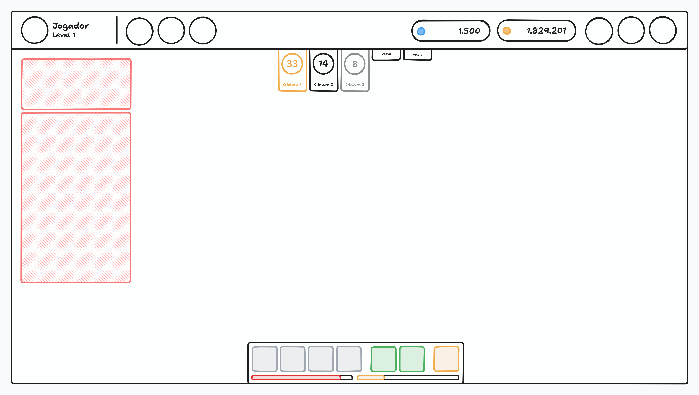
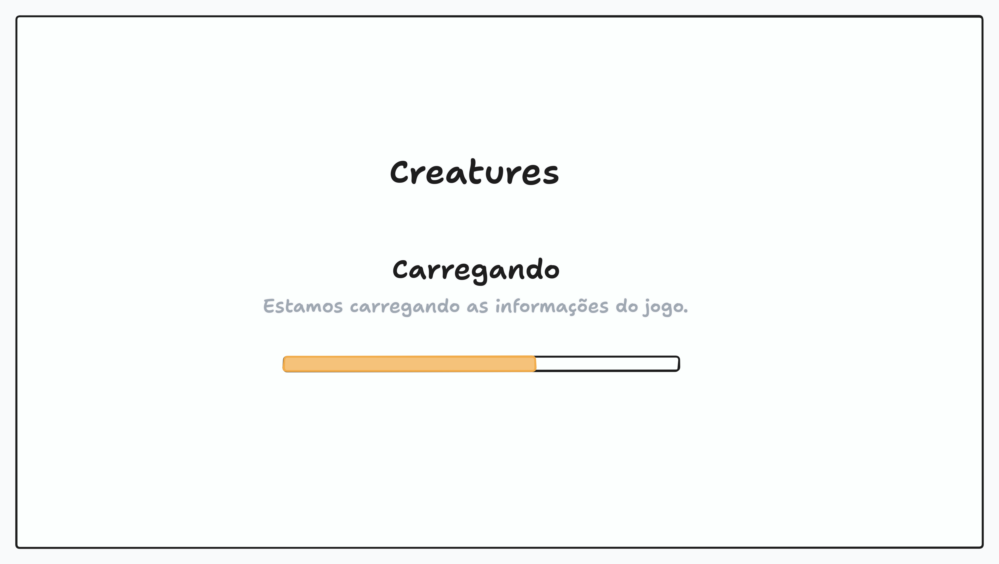
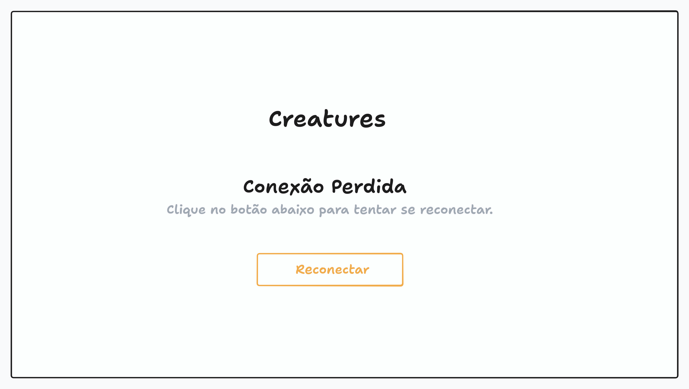

# Tela do Jogo

Este documento cobre a tela principal do jogo, onde o jogador passa a maior parte do tempo: a estrutura da tela, os elementos de acesso rápido e as informações do treinador, até os estados de conexão e o comportamento em dispositivos móveis.

> A **tela do jogo** é composta por uma **toolbar** fixa no topo, um **canvas**, que renderiza o mundo do jogo, e **elementos HTML flutuando sobre o canvas**, como o botão de play, as linguetas do time e a barra de habilidades. O que é renderizado dentro do canvas (mapa, criaturas, vida, chat, informações do alvo etc.) é tema de um documento próprio, assim como cada modal e menu aberto a partir dessa tela.

> Este documento cobre **a tela em si**. Cada módulo aberto a partir dela — o modal da [mochila](BACKPACK.md), o modal de [locais de caça](HUNT_AREA_SELECT.md), o modal do [armazenamento](STORAGE.md), a configuração da barra de habilidades — tem documento próprio, e aqui só interessa o acesso a eles.

## Visão Geral

O jogo é em pixel art e visto de cima (top down), inspirado em Pokémon do GBA e em Tibia, com mais foco nas criaturas. É um jogo idle, pensado para ser aberto e acompanhado a qualquer momento, em desktops e celulares.

A tela reúne os acessos rápidos aos módulos do jogo e as informações que importam no momento, e o que ela exibe depende do que o jogador está fazendo.

> Toda a simulação do jogo acontece no serviço. O cliente envia comandos, o serviço valida e processa, e devolve o resultado para o cliente renderizar. A tela do jogo nunca decide nada por conta própria.

A tela fica na rota `/game` e o acesso é feito pela [tela de lista de treinadores](AUTHENTICATION.md#tela-de-lista-de-treinadores), ao entrar com um treinador. É uma tela protegida, conforme o [controle de acesso](AUTHENTICATION.md#controle-de-acesso).

## Mockup

> O mockup é ilustrativo e mostra a disposição geral, não o design final. Ele serve para conferir a estrutura da tela, não cores, tipografia ou espaçamento.

O primeiro mockup mostra a tela na cidade. No topo, a toolbar ocupa toda a largura: à esquerda ficam o avatar do treinador, com o nível abaixo dele, e o nome; depois de um divisor vertical vem a primeira seção de botões; na direita ficam os totais de gold coins e de diamantes, e depois deles a segunda seção de botões. No centro, abaixo da toolbar, ficam as linguetas do time, com três criaturas ocupando os primeiros slots — a primeira destacada como ativa e a terceira em cinza — e dois slots vazios. Na lateral esquerda, pouco acima da barra de habilidades, fica o botão de play. A barra de habilidades fica na parte inferior, sobre a área do canvas, com os slots agrupados em habilidades, consumíveis e dispositivo, e as barras de vida e stamina abaixo dos slots. O restante do meio da tela é a área do canvas.

O segundo mockup mostra a mesma tela durante a caçada. A toolbar, as linguetas do time e a barra de habilidades são as mesmas; o que muda é a composição dos elementos de cidade e de batalha: o botão de play dá lugar aos dois painéis da caçada, que ficam no canto superior esquerdo, e os elementos de cidade, como o botão da loja, ficam de fora. O que cada painel mostra está no [analisador de caçada](HUNT_ANALYZER.md).

## Estrutura da Tela

A tela é dividida em três partes: a toolbar, o canvas e os elementos sobrepostos ao canvas.

- **Toolbar:** fixa no topo, ocupa 100% da largura da tela.
- **Canvas:** ocupa 100% da largura e todo o restante da altura, abaixo da toolbar.
- **Elementos sobrepostos:** o botão de play, as linguetas do time, os painéis da caçada e a barra de habilidades ficam por cima do canvas.

> A toolbar não fica sobre o canvas: ela ocupa o próprio espaço e o canvas começa logo abaixo, então nenhuma parte dele fica escondida. Já os elementos sobrepostos ficam por cima do canvas, que continua ocupando toda a sua área.

Nenhum elemento HTML da tela, incluindo os modais abertos a partir dela, pausa ou bloqueia o canvas. A simulação segue rodando com ou sem modais abertos, e o que o jogador pode fazer em cada momento depende só do que está acontecendo no jogo, como estar em uma cidade ou em uma batalha.

Modais e drawers seguem a convenção de [tamanho fixo](INTERFACE.md#tamanho-fixo): depois de abertos, eles não mudam de altura nem de largura por causa do conteúdo.

## Visibilidade dos Elementos

Parte dos elementos da tela existe só em alguns contextos. Elementos de cidade, como o botão de play, existem enquanto o treinador está na cidade e desaparecem nas batalhas, e o contrário também pode acontecer: elementos de batalha aparecem durante a caçada e não existem na cidade.

> A tela não é a mesma em todos os momentos, e esconder o que não faz sentido é parte da informação. Um botão de começar a caçar não tem utilidade no meio de uma batalha, e um painel de estatísticas da batalha não tem utilidade na cidade.

## Toolbar

Barra no topo da tela. Da esquerda para a direita: o treinador, um divisor vertical, a primeira seção de botões e, na extrema direita, a segunda seção de botões, mais ou menos assim:

`| Treinador | Botões --------------------- Botões |`

### Treinador

No canto esquerdo ficam o avatar do treinador e, ao lado dele, o nome, com o nível do treinador em uma label abaixo do avatar.

### Menu da Esquerda

Depois do divisor vertical ficam os botões de acesso às funcionalidades do jogo: o primeiro botão abre a [mochila](BACKPACK.md) e o segundo abre o [armazenamento](STORAGE.md). Os demais botões são placeholders para funcionalidades que ainda serão definidas.

### Menu da Direita

Uma área alinhada à direita. Antes dos botões ficam os totais das duas moedas do treinador, cada um em seu próprio retângulo: os **gold coins**, gastos e ganhos na [loja](STORE.md), e os **diamantes**, gastos em serviços como a conta paga, conforme as [moedas](TRAINER.md#moedas). Depois vêm os botões de acesso: o último, na extrema direita, é o de **Configurações**, o menu principal do jogo, com as configurações do jogo e outras opções. Os demais botões são placeholders para funcionalidades que ainda serão definidas.

> O botão da extrema direita é o de **Configurações**, e ele abre um menu com duas ações: **"Trocar treinador"**, que desconecta o treinador do serviço e leva o jogador de volta para a [tela de lista de treinadores](AUTHENTICATION.md#tela-de-lista-de-treinadores), e **"Sair da conta"**, que encerra a sessão conforme descrito na [sessão](AUTHENTICATION.md#sessão), e é a mesma ação do botão "Sair da conta" da tela de lista de treinadores. O comportamento da desconexão está em [conexão e atividade idle](#conexão-e-atividade-idle).

> "Trocar treinador" não encerra a sessão: a conta continua autenticada, e o jogador volta apenas para a lista de treinadores. Quem quer encerrar a sessão usa "Sair da conta".

## Linguetas do Time

Logo abaixo da toolbar e sobre o canvas, as linguetas ficam centralizadas na tela, em uma linha, com no máximo 5 criaturas, conforme as regras do [time](TRAINER.md#time).

- **Slot preenchido:** lingueta maior, que exibe o retrato da criatura, com o nível dentro dele, e o nome da espécie abaixo.
- **Slot vazio:** lingueta menor, sem informações, indicando que ainda há espaço no time.

> A lingueta não mostra o elemento da criatura nem o seu apelido. O elemento está no slot da habilidade, na [barra de habilidades](SKILL_BAR.md), e o apelido de uma criatura recém-capturada é o nome do treinador — o nome da espécie é o que identifica a criatura.

> A lingueta da criatura ativa é destacada. Se o treinador estiver em uma batalha, é a criatura que está em campo. Se estiver na cidade, por exemplo, é a criatura que será chamada assim que uma batalha começar.

> A vida da criatura não é exibida na lingueta: ela é renderizada no canvas e acompanhada na [barra de habilidades](SKILL_BAR.md), que mostra a vida da criatura ativa. Se a criatura estiver desmaiada, o avatar dela é exibido em tons de cinza e com opacidade reduzida.

### Troca de Criatura

Clicar em uma criatura apta, em qualquer posição, a coloca no lugar da criatura ativa, e a troca é instantânea. As regras da troca, incluindo a espera entre uma troca e outra, estão em [Troca Manual](TRAINER.md#troca-manual).

> Durante a espera, os slots recebem uma máscara com a contagem e a [animação de cooldown](INTERFACE.md#animação-de-cooldown), para o jogador entender que a troca está em cooldown, e não impedida por um erro.

> As linguetas servem para clicar e selecionar a criatura em batalha e para acompanhar o estado das criaturas. Adicionar, remover e reordenar criaturas não acontece nos slots: o remanejo do time é feito fora de uma caçada, na cidade, conforme [Time](TRAINER.md#time).

## Botão de Play

O botão de play fica na lateral esquerda da tela, encostado na borda, um pouco acima da altura da barra de habilidades. Ele aparece apenas na cidade e desaparece nas batalhas.

Ao clicar, o jogador abre o modal de [seleção de área de caça](HUNT_AREA_SELECT.md). Ele é o único acesso aos locais de caça: a toolbar não tem nenhum botão que abra esse modal.

> O botão de play só existe na cidade, e o modal de locais de caça só se abre por ele. Por isso, trocar de área no meio de uma caçada é impossível: o jogador precisa primeiro sair da caçada, conforme [Trocar de Área](HUNT.md#trocar-de-área).

> O play é o atalho que aparece quando o jogador está parado, na cidade, que é justamente quando ele vai querer começar uma caçada.

## Painéis da Caçada

Durante a caçada, o canto superior esquerdo da tela, logo abaixo da toolbar, recebe dois painéis flutuando sobre o canvas: o painel da sessão e o [analisador de caçada](HUNT_ANALYZER.md).

Os painéis são flutuantes: ficam por cima do canvas, sem empurrá-lo, como a barra de habilidades. O que cada painel mostra, os números da análise e o botão de finalizar a caçada estão no documento do [analisador de caçada](HUNT_ANALYZER.md).

> Os painéis existem só durante a caçada e somem na cidade, como os demais elementos de batalha.

## Botão da Loja

O botão da loja fica flutuando sobre o canvas, logo acima da barra de habilidades. Ele existe só na cidade e desaparece nas batalhas, como os demais elementos de cidade.

Ao clicar, o jogador abre o modal da [loja](STORE.md). A loja também é acessível pelo NPC da cidade, e os dois caminhos abrem o mesmo modal.

> O botão segue a regra dos elementos de cidade: ele existe onde dá para usá-lo. A loja é da cidade, e durante a caçada o botão não tem função.

## Barra de Habilidades

Barra flutuando sobre o canvas, na parte inferior da tela, com 7 slots divididos em 3 categorias. Abaixo dos slots ficam duas barras: a vida da criatura ativa e a [stamina](TRAINER.md#stamina) do treinador.

- **4 slots de habilidades:** as habilidades ativas da criatura em campo, usadas automaticamente pela criatura durante a caçada.
- **2 slots de consumíveis:** os consumíveis que a criatura usa em si mesma, como poções de cura, cada um com o seu gatilho de vida.
- **1 slot de dispositivo de captura:** uma vez selecionado, o dispositivo é usado automaticamente para tentar a captura quando uma criatura selvagem desmaia. Sem dispositivo selecionado, a tentativa de captura não acontece, e o resto da caçada segue normalmente.

Por meio dela o jogador acompanha o que está sendo usado e o tempo de recarga (cooldown) de cada habilidade.

> Os slots são clicáveis, e cada um abre o fluxo de configuração do que vai naquele slot. Como configurar curas, habilidades e o dispositivo de captura está em [Barra de Habilidades](SKILL_BAR.md).

> As habilidades exibidas são da criatura ativa, então esses slots mudam quando a criatura ativa muda. Uma criatura pode ter muito mais habilidades do que as 4 equipadas.

## Responsividade

O jogo precisa rodar bem em celulares e desktops, em qualquer tamanho de tela, e os elementos da tela se adaptam ao espaço disponível. Os detalhes de como a toolbar, as linguetas e a barra de habilidades se comportam em telas pequenas serão definidos em [Interface](INTERFACE.md).

### Orientação

Em celulares, o jogo funciona somente na horizontal (modo paisagem). Quando a tela está na vertical (modo retrato), é exibido um overlay totalmente preto, sobre toda a tela, com o título "Vire o celular" e a descrição "Para jogar, coloque o celular na horizontal.". O overlay não possui botão e desaparece sozinho assim que a tela volta para a horizontal.

## Estados da Tela

Quando o jogador não consegue ver o jogo, é exibida uma tela cheia com fundo preto, um título centralizado, uma descrição logo abaixo e, quando necessário, um botão. Existem apenas dois estados, e eles cobrem todos os casos.

| Estado | Título | Descrição | Botão |
| --- | --- | --- | --- |
| Carregando | Carregando | Estamos preparando o seu treinador. Isso pode levar alguns instantes. | Nenhum, com barra de carregamento |
| Conexão perdida | Conexão perdida | Você perdeu a conexão com o servidor. Clique no botão abaixo para tentar se reconectar. | Reconectar |

> Os mockups são ilustrativos e mostram a composição das telas, não o design final: servem para conferir a estrutura, não cores, tipografia ou espaçamento. Os dois estados levam o nome do jogo no topo, o título centralizado e a descrição abaixo, e só a conexão perdida tem o botão para agir.

> A tela de **carregando** é exibida sempre que uma área precisa ser carregada: ao entrar no jogo, até que o estado do treinador seja recebido do serviço e esteja pronto para ser renderizado, e também ao entrar em uma caçada, ao voltar para a cidade e em qualquer outra troca de área. Se não for possível carregar, é exibida a tela de conexão perdida.

> A tela de **conexão perdida** cobre qualquer motivo que impeça o jogo de continuar: a conexão caiu, o servidor ficou fora do ar, a sessão foi perdida ou qualquer outro problema. Não existe tentativa automática de reconexão: é o botão que dispara a nova tentativa.

> Ao clicar em "Reconectar", o cliente tenta restabelecer a conexão. Se conseguir, o jogador volta direto para o jogo, já com o estado atualizado. Se não conseguir, permanece na tela e pode clicar de novo.

## Conexão e Atividade Idle

Cada conta só pode estar conectada com um treinador por vez. Se o jogador entra com um segundo treinador, ou com o mesmo treinador em outra aba ou dispositivo, a conexão anterior é derrubada e exibe a tela de [conexão perdida](#estados-da-tela).

> Fechar a aba ou o navegador não envia nenhum aviso ao serviço, que percebe a queda da conexão por conta própria. Se o treinador estiver caçando, a caçada continua sozinha (idle) até o fim da [sessão offline](TRAINER.md#sessão-offline) da conta, consumindo stamina normalmente, e ao reabrir o jogo o jogador encontra tudo atualizado. Se o treinador estiver na [cidade](CITY.md), não existe nada para continuar: ele apenas desconecta.

> Ao usar "Trocar treinador" no menu Configurações, o cliente avisa o serviço de que está se desconectando. Nesse caso o treinador para qualquer atividade e não continua jogando sozinho.

## Escopo das Fases Alfa e Beta

Os pontos abaixo ainda estão em aberto ou são provisórios nesta fase e devem ser revistos conforme o jogo evolui:

- Os botões dos menus da toolbar, com exceção dos de Mochila, Armazenamento e Configurações, são placeholders para funcionalidades ainda não definidas.
- Os detalhes de como a tela se adapta a telas pequenas ainda serão definidos junto com o design da interface.
- O painel de estatísticas da batalha, que aparece durante as caçadas, ainda não existe.
