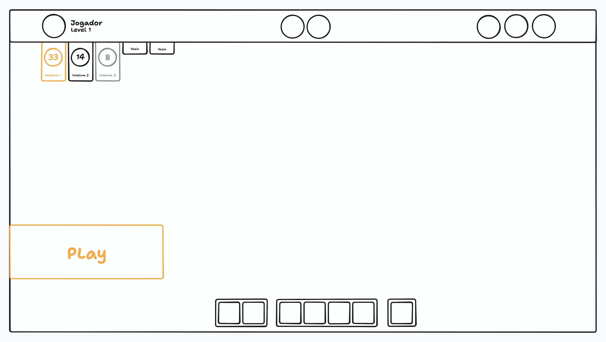

# Tela do Jogo

Este documento cobre a tela principal do jogo, onde o jogador passa a maior parte do tempo: a estrutura da tela, os elementos de acesso rápido e as informações do treinador, até os estados de conexão e o comportamento em dispositivos móveis.

> A **tela do jogo** é composta por uma **toolbar** fixa no topo, um **canvas**, que renderiza o mundo do jogo, e **elementos HTML flutuando sobre o canvas**, como o botão de play, as linguetas do time e a barra de habilidades. O que é renderizado dentro do canvas (mapa, criaturas, vida, chat, informações do alvo etc.) é tema de um documento próprio, assim como cada modal e menu aberto a partir dessa tela.

> Este documento cobre **a tela em si**. Cada módulo aberto a partir dela — o modal de locais de caça, o menu do armazenamento, a configuração da barra de habilidades — tem documento próprio, e aqui só interessa o acesso a eles.

## Visão Geral

O jogo é em pixel art e visto de cima (top down), inspirado em Pokémon do GBA e em Tibia, com mais foco nas criaturas. É um jogo idle, pensado para ser aberto e acompanhado a qualquer momento, em desktops e celulares.

A tela reúne os acessos rápidos aos módulos do jogo e as informações que importam no momento, e o que ela exibe depende do que o jogador está fazendo.

> Toda a simulação do jogo acontece no serviço. O cliente envia comandos, o serviço valida e processa, e devolve o resultado para o cliente renderizar. A tela do jogo nunca decide nada por conta própria.

A tela fica na rota `/game` e o acesso é feito pela [tela de lista de treinadores](AUTHENTICATION.md#tela-de-lista-de-treinadores), ao entrar com um treinador. É uma tela protegida, conforme o [controle de acesso](AUTHENTICATION.md#controle-de-acesso).

## Mockup

> O mockup é ilustrativo e mostra a disposição geral, não o design final. Ele serve para conferir a estrutura da tela, não cores, tipografia ou espaçamento.

O mockup mostra a tela em uma safe zone. No topo, a toolbar ocupa toda a largura, com o avatar, o nome e o nível do treinador à esquerda e espaços para os botões dos menus central e direito. Abaixo do avatar, à esquerda, ficam as linguetas do time, com três criaturas ocupando os primeiros slots — a primeira destacada como ativa e a terceira em cinza — e dois slots vazios. Na lateral esquerda, pouco acima da barra de habilidades, fica o botão de play. A barra de habilidades fica na parte inferior, sobre a área do canvas, com os slots agrupados em cura, habilidades e captura. O restante do meio da tela é a área do canvas.

## Estrutura da Tela

A tela é dividida em três partes: a toolbar, o canvas e os elementos sobrepostos ao canvas.

- **Toolbar:** fixa no topo, ocupa 100% da largura da tela.
- **Canvas:** ocupa 100% da largura e todo o restante da altura, abaixo da toolbar.
- **Elementos sobrepostos:** o botão de play, as linguetas do time e a barra de habilidades ficam por cima do canvas.

> A toolbar não fica sobre o canvas: ela ocupa o próprio espaço e o canvas começa logo abaixo, então nenhuma parte dele fica escondida. Já os elementos sobrepostos ficam por cima do canvas, que continua ocupando toda a sua área.

Nenhum elemento HTML da tela, incluindo os modais abertos a partir dela, pausa ou bloqueia o canvas. A simulação segue rodando com ou sem modais abertos, e o que o jogador pode fazer em cada momento depende só do que está acontecendo no jogo, como estar em uma cidade ou em uma batalha.

## Visibilidade dos Elementos

Parte dos elementos da tela existe só em alguns contextos. Elementos de safe zone, como o botão de play, aparecem na cidade e desaparecem nas batalhas, e o contrário também pode acontecer: elementos de batalha aparecem durante a caçada e não existem na cidade.

> A tela não é a mesma em todos os momentos, e esconder o que não faz sentido é parte da informação. Um botão de começar a caçar não tem utilidade no meio de uma batalha, e um painel de estatísticas da batalha não tem utilidade na cidade.

## Toolbar

Barra no topo da tela, dividida em três áreas: treinador à esquerda, menu central e menu da direita, mais ou menos assim: `| Treinador ---------- Menu Central ---------- Menu Direita |`.

### Treinador

No canto esquerdo ficam o avatar do treinador e, ao lado dele, o nome, com o nível logo abaixo.

### Menu Central

Uma área centralizada com botões de acesso às funcionalidades do jogo. Por enquanto, o primeiro botão é o de **Áreas de Caça**, que abre o modal de [seleção de área de caça](HUNT_AREA_SELECT.md). Os demais botões são placeholders para funcionalidades que ainda serão definidas.

### Menu da Direita

Uma área alinhada à direita, também com botões de acesso. O último botão, na extrema direita, é o de **Configurações**, o menu principal do jogo, com as configurações do jogo e outras opções. Os demais botões são placeholders para funcionalidades que ainda serão definidas.

> Dentro do menu Configurações ficam a opção "Trocar treinador", que desconecta o treinador do serviço e leva o jogador de volta para a [tela de lista de treinadores](AUTHENTICATION.md#tela-de-lista-de-treinadores), e a opção "Sair", que encerra a sessão conforme descrito na [sessão](AUTHENTICATION.md#sessão), e é a mesma ação da opção "Sair" da tela de lista de treinadores. O comportamento da desconexão está em [conexão e atividade idle](#conexão-e-atividade-idle).

## Linguetas do Time

Logo abaixo da toolbar e sobre o canvas, as linguetas ficam alinhadas à esquerda, em uma linha que começa debaixo do avatar do treinador, com no máximo 5 criaturas, conforme as regras do [time](TRAINER.md#time).

- **Slot preenchido:** lingueta maior, que exibe o avatar, o nome e o nível da criatura.
- **Slot vazio:** lingueta menor, sem informações, indicando que ainda há espaço no time.

> A lingueta da criatura ativa é destacada em vermelho. Se o treinador estiver em uma batalha, é a criatura que está em campo. Se estiver fora de uma batalha, em uma cidade por exemplo, é a criatura que será chamada assim que uma batalha começar.

> A vida da criatura não é exibida na lingueta, pois já é renderizada no canvas. Se a criatura estiver desmaiada, o avatar dela é exibido em tons de cinza e com opacidade reduzida.

### Troca de Criatura

Clicar em uma criatura apta, em qualquer posição, a coloca no lugar da criatura ativa, e a troca é instantânea. As regras da troca, incluindo a espera entre uma troca e outra, estão em [Troca Manual](TRAINER.md#troca-manual).

> Durante a espera, os slots recebem uma máscara com a contagem, para o jogador entender que a troca está em cooldown, e não impedida por um erro.

> As linguetas servem para clicar e selecionar a criatura em batalha e para acompanhar o estado das criaturas. Adicionar, remover e reordenar criaturas não acontece nos slots: o remanejo do time é feito fora de uma caçada, na cidade, conforme [Time](TRAINER.md#time).

## Botão de Play

O botão de play fica na lateral esquerda da tela, encostado na borda, um pouco acima da altura da barra de habilidades. Ele aparece apenas nas safe zones e desaparece nas batalhas.

Ao clicar, o jogador abre o modal de [seleção de área de caça](HUNT_AREA_SELECT.md), o mesmo modal que o botão **Áreas de Caça** da toolbar abre.

> O botão de play é a mesma ação em dois lugares, e não duas ações diferentes. A toolbar é o acesso de sempre; o play é o atalho que aparece quando o jogador está parado, em uma safe zone, que é justamente quando ele vai querer começar uma caçada.

> Como o botão de play não existe nas batalhas, a troca de área no meio de uma caçada é feita pelo botão Áreas de Caça da toolbar, que está sempre disponível.

## Barra de Habilidades

Barra flutuando sobre o canvas, na parte inferior da tela, com 7 slots divididos em 3 categorias:

- **2 slots de cura:** o jogador escolhe o que vai em cada um, entre poções de cura e magias de cura da criatura em batalha, quando ela as tiver. Uma criatura com habilidade de cura pode ocupar os dois slots com uma poção e uma magia, em qualquer ordem.
- **4 slots de habilidades:** as habilidades da criatura ativa, de ataque, suporte, defesa, o que for, exceto as de cura, que ficam na primeira categoria.
- **1 slot de dispositivo de captura:** uma vez selecionado, o dispositivo é usado automaticamente para tentar a captura quando uma criatura selvagem desmaia.

Por meio dela o jogador acompanha o que está sendo usado e o tempo de recarga (cooldown) de cada habilidade.

> Os slots são clicáveis, e cada um abre o fluxo de configuração do que vai naquele slot. Como configurar curas, habilidades e o dispositivo de captura será descrito em um documento próprio da barra de habilidades.

> As habilidades e as curas exibidas são da criatura ativa, então esses slots mudam quando a criatura ativa muda. Uma criatura pode ter muito mais habilidades do que as 4 equipadas.

## Responsividade

O jogo precisa rodar bem em celulares e desktops, em qualquer tamanho de tela, e os elementos da tela se adaptam ao espaço disponível. Os detalhes de como a toolbar, as linguetas e a barra de habilidades se comportam em telas pequenas serão definidos junto com o design da interface.

### Orientação

Em celulares, o jogo funciona somente na horizontal (modo paisagem). Quando a tela está na vertical (modo retrato), é exibido um overlay totalmente preto, sobre toda a tela, com o título "Vire o celular" e a descrição "Para jogar, coloque o celular na horizontal.". O overlay não possui botão e desaparece sozinho assim que a tela volta para a horizontal.

## Estados da Tela

Quando o jogador não consegue ver o jogo, é exibida uma tela cheia com fundo preto, um título centralizado, uma descrição logo abaixo e, quando necessário, um botão. Todos os estados abaixo seguem esse mesmo modelo.

| Estado | Título | Descrição | Botão |
| --- | --- | --- | --- |
| Carregando | Carregando | Estamos preparando o seu treinador. Isso pode levar alguns instantes. | Nenhum, com barra de carregamento |
| Tentando reconectar | Tentando reconectar | Você perdeu a conexão com o servidor. Estamos tentando reconectar automaticamente. | Nenhum |
| Conexão perdida | Conexão perdida | Você perdeu a conexão com o servidor. Clique no botão abaixo para tentar se reconectar. | Reconectar |
| Sessão expirada | Sessão expirada | Sua sessão expirou. Faça login novamente para continuar jogando. | Fazer login |

> A tela de **carregando** é exibida ao entrar no jogo, até que o estado do treinador seja recebido do serviço e esteja pronto para ser renderizado. Se não for possível carregar, é exibida a tela de conexão perdida.

> Ao perder a conexão, o cliente tenta reconectar sozinho algumas vezes, exibindo a tela de **tentando reconectar**. Se não conseguir, é exibida a tela de **conexão perdida**, e ao clicar em "Reconectar" o cliente volta para a tela de tentando reconectar. Se a conexão é restabelecida em qualquer momento, o jogador volta direto para o jogo, já com o estado atualizado.

> Se a sessão expira enquanto o jogador está no jogo, é exibida a tela de **sessão expirada**, e ao clicar em "Fazer login" o jogador é redirecionado para a [tela de login](AUTHENTICATION.md#tela-de-login). Se a sessão já estiver expirada ao acessar a tela do jogo, o usuário é redirecionado direto para a tela de login, conforme o [controle de acesso](AUTHENTICATION.md#controle-de-acesso).

## Conexão e Atividade Idle

Cada conta só pode estar conectada com um treinador por vez. Se o jogador entra com um segundo treinador, ou com o mesmo treinador em outra aba ou dispositivo, a conexão anterior é derrubada e exibe a tela de [conexão perdida](#estados-da-tela).

> Fechar a aba ou o navegador não envia nenhum aviso ao serviço, que percebe a queda da conexão por conta própria. Se o treinador estiver caçando, a caçada continua sozinha (idle) até o fim da [sessão offline](TRAINER.md#sessão-offline) da conta, consumindo stamina normalmente. Ao reabrir o jogo, o jogador encontra tudo atualizado.

> Ao usar "Trocar treinador" no menu Configurações, o cliente avisa o serviço de que está se desconectando. Nesse caso o treinador para qualquer atividade e não continua jogando sozinho.

## Escopo das Fases Alfa e Beta

Os pontos abaixo ainda estão em aberto ou são provisórios nesta fase e devem ser revistos conforme o jogo evolui:

- Os botões dos menus da toolbar, com exceção de Áreas de Caça e Configurações, são placeholders para funcionalidades ainda não definidas.
- Os detalhes de como a tela se adapta a telas pequenas ainda serão definidos junto com o design da interface.
- A quantidade de tentativas automáticas de reconexão ainda não foi definida.
- O painel de estatísticas da batalha, que aparece durante as caçadas, ainda não existe.
