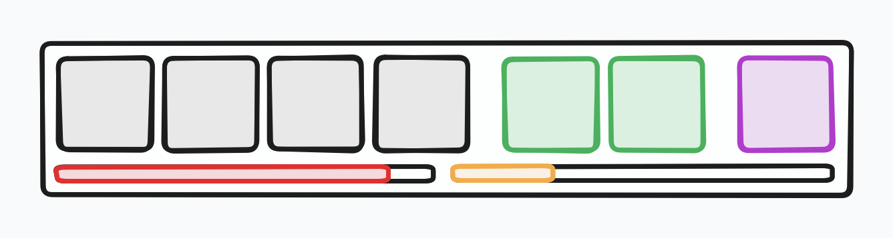
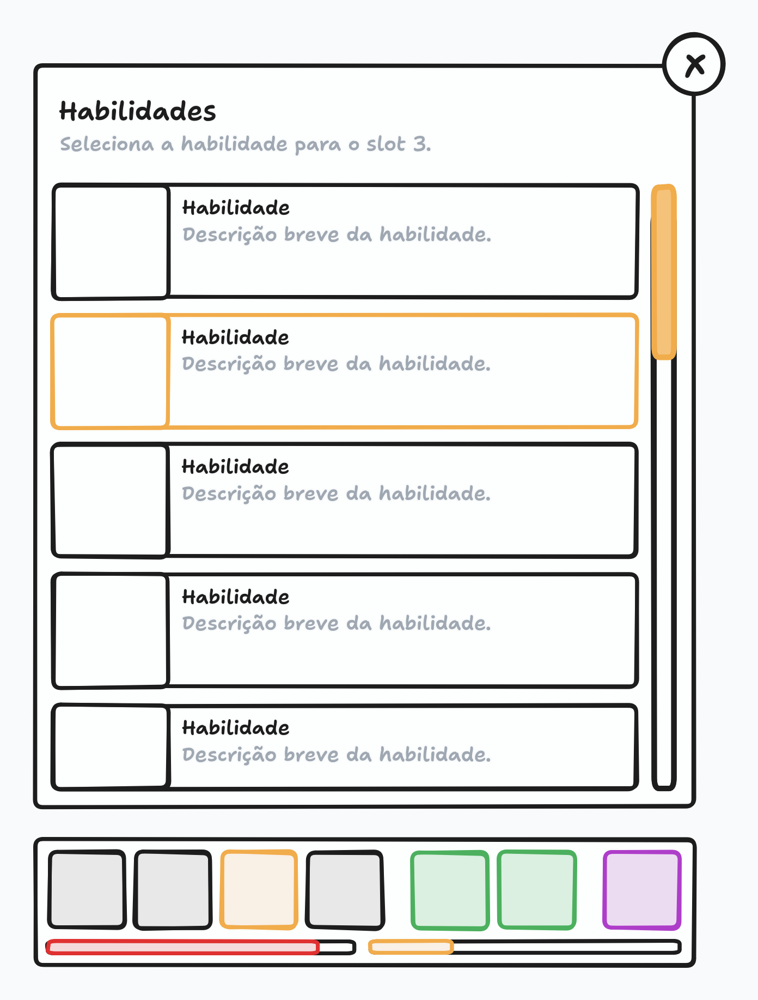
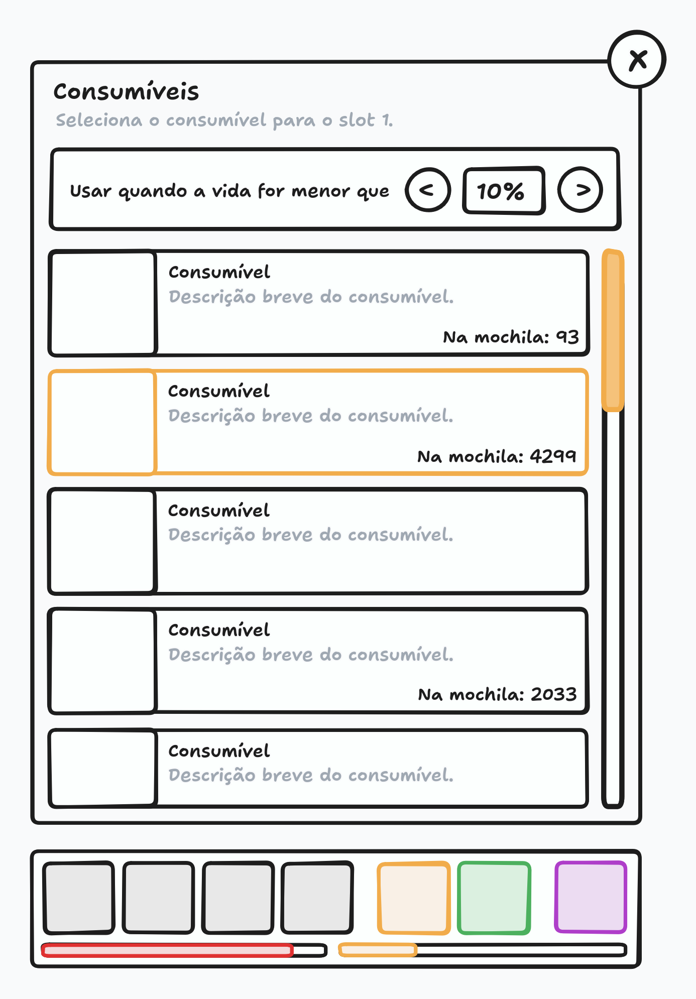
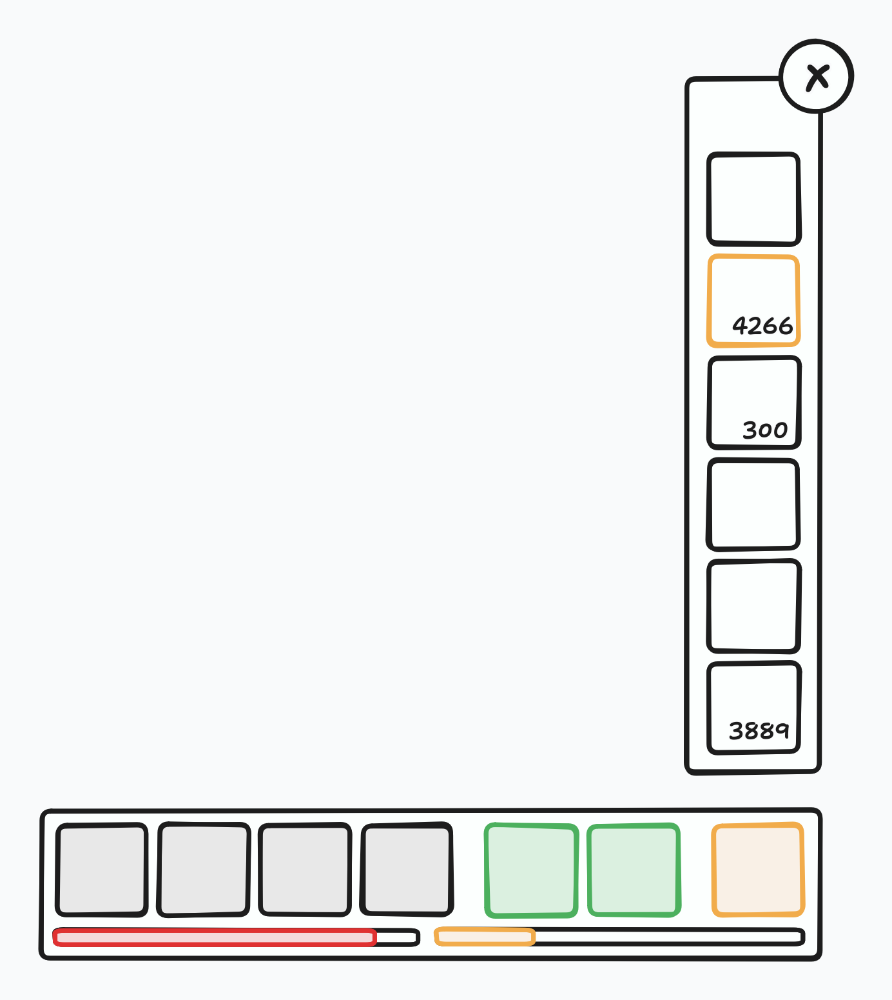

# Barra de Habilidades

Este documento cobre a barra de habilidades: o que ela exibe, como os grupos de slots funcionam, como o jogador equipa habilidade, consumível ou dispositivo, e como a criatura usa cada coisa sozinha durante a caçada.

> Este documento cobre **a barra de habilidades**. A tela de onde ela faz parte é a [Tela do Jogo](PLAY_SCREEN.md), e as criaturas, o time e a stamina estão em [Treinador](TRAINER.md).

## Visão Geral

A barra de habilidades flutua sobre o canvas, na parte inferior da tela, e existe o tempo todo, na cidade e durante a caçada. Ela reúne 7 slots divididos em 3 grupos, que a criatura ativa usa sozinha durante a caçada:

- **4 slots de habilidades:** as habilidades ativas da criatura em campo.
- **2 slots de consumíveis:** o que a criatura usa em si mesma, como poções de cura.
- **1 slot de dispositivo:** o dispositivo de captura usado quando uma criatura selvagem desmaia.

Todo o conteúdo da barra é da criatura ativa, com uma exceção: o slot de dispositivo é configuração do treinador e não da criatura. Quando a criatura ativa muda, a barra muda na hora, e os slots passam a mostrar o que a criatura nova tem equipado.

Abaixo dos slots ficam duas barras: a vida da criatura ativa e a [stamina](TRAINER.md#stamina) do treinador. A vida representada é a da criatura em campo, a mesma que as habilidades representam — trocou de criatura, a barra passa a mostrar a vida da criatura nova.

A barra da stamina mostra o percentual restante de forma visual, e o rótulo da barra mostra o tempo que ainda resta, em horas e minutos. São duas formas de dizer a mesma coisa, e por isso o rótulo não repete a porcentagem: o tempo é o que o jogador planeja, e a porcentagem já está na barra.

Os slots são clicáveis. Clicar em um slot abre o painel de seleção daquele grupo, por cima da barra, e é assim que o jogador equipa ou troca o que está no slot.

> A barra é o painel de controle da caçada: o jogador monta a criatura antes e durante a caçada, e a criatura executa sozinha o que está equipado.

## Uso Automático

Durante a caçada, a criatura usa sozinha o que está na barra. Habilidades e consumíveis seguem as mesmas três regras de ativação, e o que está em cooldown mostra o progresso pelo ícone, pela [animação de cooldown](INTERFACE.md#animação-de-cooldown):

1. **Da esquerda para a direita:** quando mais de uma coisa pode ser usada, a da esquerda vem primeiro.
2. **Intervalo mínimo de 1 segundo:** a criatura espera pelo menos 1 segundo entre um uso e outro. Sem esse intervalo, as 4 habilidades disparariam juntas no primeiro segundo de caçada.
3. **Prioridade para quem já estava pronta:** no momento de usar, se uma habilidade acabou de sair do cooldown e outra já estava sem cooldown, a que já estava pronta ganha. Se todas estiverem saindo do cooldown juntas, vale a regra da esquerda para a direita.

Com cooldowns de 4s, 2s, 2s e 1s, da esquerda para a direita, a rotação corre assim: a primeira dispara no segundo 0, a segunda no 1 e a terceira no 2. No segundo 3, a quarta dispara, ganhando da segunda, que tinha acabado de ficar pronta. No 4, dispara a segunda, que já estava pronta enquanto a primeira e a terceira saíam do cooldown. No 5, sobraram três habilidades já prontas, e a esquerda para a direita manda: dispara a primeira.

Nenhuma habilidade ou consumível tem cooldown menor que o intervalo de ativação, ou seja, menor que 1 segundo. Um cooldown menor faria a mesma habilidade ficar pronta antes de todo intervalo seguinte e disparar sempre, sem deixar as outras serem usadas.

> O piso de 1 segundo é o que mantém a rotação honesta: uma habilidade de cooldown curto dispara rápido, mas sempre dá espaço para as outras no intervalo seguinte.

### Habilidades

Os 4 slots de habilidade mostram as 4 habilidades equipadas da criatura ativa. Cada habilidade tem o seu cooldown, e a criatura as usa sozinha seguindo as regras de ativação. As habilidades de cada espécie, seus elementos e cooldowns estão em [Criaturas](CREATURES.md#habilidades).

Equipar uma habilidade no meio de uma caçada a coloca em cooldown na hora: uma habilidade de 7 segundos recém-colocada só dispara depois dos 7 segundos. A regra vale para qualquer troca, em qualquer lugar, e existe para o jogador não ficar trocando habilidades para criar combos que não existiriam.

O cooldown é da habilidade da criatura, e não do slot: cada criatura tem as suas habilidades e os seus cooldowns, e duas criaturas iguais, com as mesmas habilidades nos mesmos slots, não compartilham nada. Trocar de criatura não zera cooldown nenhum — a que sai mantém os seus, e a que entra vem com os seus próprios. Uma criatura que nunca entrou em batalha chega com tudo pronto, e uma que já lutou pode voltar com habilidades em cooldown, que só ficam prontas quando o tempo passar.

Tirar uma habilidade e colocá-la de volta também a coloca em cooldown, mesmo sendo a mesma habilidade: uma habilidade tirada faltando 4 segundos para acabar volta para o cooldown cheio, sem nem ter sido usada. A regra fecha a porta do truque de tirar e colocar para burlar a espera.

> A habilidade que entra em cooldown não quebra a rotação: quando o cooldown dela acaba, ela é uma habilidade que acabou de sair do cooldown, e perde a prioridade para as que já estavam prontas.

### Consumíveis

Os 2 slots de consumível funcionam como os de habilidade — mesmas regras de ativação, mesmo intervalo mínimo de 1 segundo, cooldown próprio de cada consumível —, com duas diferenças.

A primeira: o consumo não compartilha o intervalo com as habilidades. A criatura pode usar um consumível no mesmo segundo em que usou uma habilidade, porque são dois relógios separados: cooldown de habilidade é para habilidades, cooldown de consumível é para consumíveis.

A segunda: cada slot de consumível tem o seu gatilho de vida. O jogador escolhe a porcentagem em que aquele consumível deve ser usado, e a ativação respeita a escolha: uma poção forte pode ser configurada para disparar quando a vida estiver com 30% ou menos, e uma mais fraca quando estiver com 70% ou menos, cada uma no seu slot.

Como nas habilidades, equipar ou trocar um consumível vem com o cooldown dele: um consumível de 2 segundos recém-colocado só pode ser usado depois dos 2 segundos.

### Dispositivos

O slot de dispositivo não é da criatura: é configuração do treinador e vale em qualquer caçada. Ele guarda o dispositivo usado para tentar a captura, e a captura acontece sozinha quando uma criatura selvagem desmaia, usando o dispositivo que está selecionado.

Sem dispositivo selecionado, a tentativa de captura não acontece — e a caçada segue normalmente: a batalha rola, a criatura ganha experiência e loot, só não há captura. A captura exige as duas coisas juntas: um dispositivo selecionado na barra e quantidade dele na mochila. A chance de captura da espécie e o multiplicador de cada dispositivo estão em [Captura](CREATURES.md#captura), e a criatura capturada não dropa itens, conforme as regras de [drops](CREATURES.md#drops).

## Seleção do Slot

Clicar em um slot abre o painel de seleção daquele grupo, por cima da barra. Nos três painéis a interação é a mesma: clicar em um item seleciona para o slot, e clicar de novo no item selecionado limpa o slot.

### Painel de Habilidades

O painel tem o título **Habilidades**, o subtítulo com o slot de destino — "Seleciona a habilidade para o slot 3." — e a lista de habilidades da criatura ativa. Cada habilidade é um card com imagem, título e descrição.

Habilidade que já está em outro slot não aparece na lista, porque a mesma habilidade não pode ocupar dois slots. O serviço valida isso de todo jeito: se uma habilidade acabar duplicada, a cópia do slot anterior some, e ela fica só no slot novo, com o slot anterior vazio.

Habilidade que a criatura tem mas não pode usar por nível fica desabilitada, com um aviso do tipo "Nível mínimo de 30 não alcançado". Se a criatura não tiver nenhuma habilidade, a lista dá lugar à mensagem **Nenhuma habilidade disponível**.

> A lista é sempre da criatura ativa. Cada criatura tem os seus slots, e trocar de criatura troca a lista e o que está equipado.

### Painel de Consumíveis

O painel tem o título **Consumíveis** e lista **todos** os consumíveis, não só os que estão na mochila. Cada card mostra a descrição e a quantidade que o treinador tem — "Na mochila: 93" —, e o consumível sem quantidade nenhuma fica desabilitado e mais transparente: dá para ver que ele existe, mas não dá para selecionar. A ordem é a dos dispositivos, do mais fraco para o mais forte: as poções mais fracas embaixo e as mais fortes em cima.

No topo do painel fica o gatilho de vida do slot: "Usar quando a vida for menor que" e a porcentagem, que o jogador ajusta para mais e para menos.

> Listar todos os consumíveis dá ao jogador o mapa completo do que existe, com os mais fortes e os mais fracos visíveis, mesmo sem ter nada na mochila. O que muda com a quantidade é só a interação.

### Painel de Dispositivos

O painel de dispositivo é o mais simples dos três: uma coluna com os dispositivos, o pior embaixo e o melhor em cima, cada um mostrando a quantidade que o treinador tem. Dispositivo sem quantidade fica desabilitado e mais transparente, e clicar seleciona ou limpa, como nos outros painéis.

> A coluna ordenada do pior para o melhor é a própria informação: o jogador vê a linha de evolução dos dispositivos e sabe onde está, mesmo sem poder usar os de cima.

## Comportamento

Habilidades e consumíveis podem ser trocados o tempo todo, na cidade e durante a caçada. Trocar, em qualquer lugar, coloca a habilidade ou o consumível recém-equipado em cooldown, conforme as regras de ativação.

> Trocar é permitido porque a regra do cooldown já cuida do abuso: quem troca rápido não ganha nada, porque o que entra nasce em cooldown.

Voltar para a cidade não zera nenhum cooldown, de habilidade ou de consumível. Cooldown se cura com o passar do tempo, e a cidade tem o [local de cura](CITY.md#local-de-cura) para o que a cura resolve — o tempo cura o resto.

## Mockup

> O mockup é ilustrativo e mostra a disposição geral, não o design final. Ele serve para conferir a estrutura da tela, não cores, tipografia ou espaçamento.

O mockup mostra a barra com os 7 slots e, abaixo deles, a barra de vida e a barra de stamina. O segundo mostra a seleção de habilidade: um modal com a lista de habilidades da criatura, o slot de destino no subtítulo e a habilidade escolhida em destaque. O terceiro mostra a seleção de consumível, com o gatilho de vida no topo e a quantidade de cada um na mochila. O quarto mostra a seleção de dispositivo, em uma coluna com as quantidades.

## Escopo das Fases Alfa e Beta

Os pontos abaixo ainda estão em aberto ou são provisórios nesta fase e devem ser revistos conforme o jogo evolui:

- Por enquanto só existem poções como consumíveis.
- Habilidades com nível mínimo, evolução e outras regras por criatura serão documentadas junto com as criaturas.
