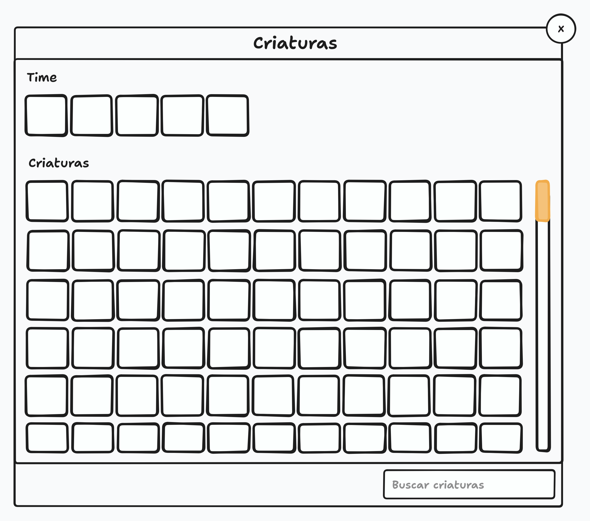
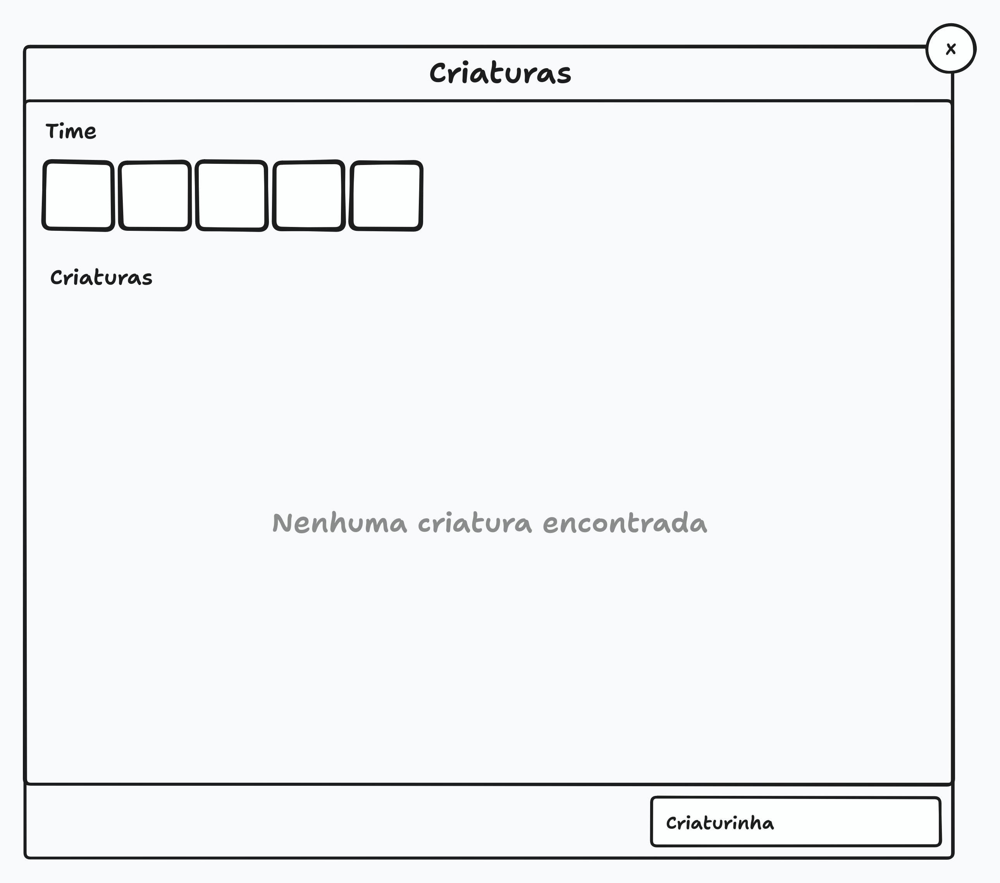

# Armazenamento

Este documento cobre o modal do armazenamento, onde o jogador vê as criaturas que capturou, com o time atual do treinador na primeira fileira.

> Este documento cobre **a interface do armazenamento**. O que é o armazenamento, onde as criaturas capturadas ficam e as regras do time estão em [Treinador](TRAINER.md#armazenamento). A tela de onde o modal é aberto é a [Tela do Jogo](PLAY_SCREEN.md).

## Visão Geral

O armazenamento é um modal aberto pelo segundo botão do menu da esquerda da [toolbar](PLAY_SCREEN.md#menu-da-esquerda) da tela do jogo, onde o jogador vê as criaturas que capturou e que não estão no time, com o time atual do treinador em destaque na primeira fileira. Por enquanto o jogador só consulta as criaturas: nenhuma interação com elas existe ainda.

A consulta vale de qualquer lugar, caçando ou não, conforme as regras do [armazenamento](TRAINER.md#armazenamento).

O modal segue o mesmo layout do [modal de locais de caça](HUNT_AREA_SELECT.md) e da [mochila](BACKPACK.md): título no topo, conteúdo no corpo e rodapé com a busca. O que ele tem de diferente é o conteúdo, dividido em duas seções: **Time** e **Criaturas**.

> O modal não pausa o jogo. A simulação continua rodando com ele aberto, conforme a regra da [tela do jogo](PLAY_SCREEN.md): nenhum elemento da tela, inclusive os modais abertos a partir dela, pausa ou bloqueia o jogo.

## Mockup

> O mockup é ilustrativo e mostra a disposição geral, não o design final. Ele serve para conferir a estrutura da tela, não cores, tipografia ou espaçamento.

O mockup mostra o modal dividido em duas seções. A primeira, **Time**, exibe uma fileira com os 5 slots do time. A segunda, **Criaturas**, exibe a grade de slots das criaturas capturadas, no mesmo formato da grade de itens da mochila, com a barra de rolagem sempre visível na lateral direita. O rodapé tem apenas o campo de busca, à direita.

O segundo mockup mostra a busca sem resultado: a grade de criaturas dá lugar à mensagem **Nenhuma criatura encontrada**, centralizada, e a seção do time continua visível acima dela.

## Estrutura do Modal

### Título e Fechamento

O modal tem o título **Armazenamento** no topo.

No canto superior direito há um botão circular com o ícone de fechar, que fecha o modal ao ser clicado, como no [modal de locais de caça](HUNT_AREA_SELECT.md#título-e-fechamento).

> Fechar o modal não altera nada, e a consulta não obriga o jogador a fazer nada.

### Time

A primeira seção, **Time**, exibe os **5 slots do time** em uma fileira, sempre, mesmo vazios, representando as criaturas que estão no time do treinador. A seção tem altura fixa e não tem rolagem, porque tem sempre os mesmos 5 slots.

A criatura ativa é destacada dentro da seção. As criaturas do time aparecem apenas aqui: elas não se repetem na grade de criaturas capturadas.

> A seção mostra o time como ele é, e não uma lista à parte: a criatura de cada slot é a criatura que está no time, conforme as regras do [time](TRAINER.md#time).

### Criaturas Capturadas

A segunda seção, **Criaturas**, exibe uma grade de slots com as criaturas capturadas que não estão no time. A grade segue exatamente a mesma regra da [grade de itens da mochila](BACKPACK.md#slots-de-itens): fileiras completas, última fileira completada com slots vazios, grade que não cria fileira nova e nenhum limite de criaturas.

A ordem é a de captura: a criatura capturada mais recentemente aparece no primeiro slot, e a leitura segue de cima para baixo, da esquerda para a direita. O modal tem [tamanho fixo](INTERFACE.md#tamanho-fixo), como o da mochila.

Uma barra de rolagem fica fixa na lateral direita da seção, sempre visível, mesmo quando o conteúdo cabe na tela.

> A [barra de rolagem](INTERFACE.md#barra-de-rolagem) sempre visível vale para toda área rolável do jogo.

### Popup da Criatura

Ao passar o cursor sobre uma criatura, é exibido um popup com informações dela, seguindo o comportamento padrão de [popup](INTERFACE.md#popup) da interface. Por enquanto o popup exibe apenas o **nome da criatura**, e exibirá mais informações no futuro.

### Busca

No rodapé do modal, à direita, há um campo de busca, como no dos outros modais, que filtra as criaturas capturadas pelo **nome da criatura**. O campo tem o placeholder **Buscar criaturas**.

A busca ignora acentos e maiúsculas: "monstrinho" encontra "Monstrinho", e o jogador não depende de acertar a acentuação.

Quando a busca não encontra nenhuma criatura, a seção de criaturas exibe a mensagem **Nenhuma criatura encontrada**, centralizada, no lugar da grade de slots. A seção do time continua visível acima, e a área da grade fica sem rolagem.

### Interações com o Time

Quando existirem, as ações que mudam o time — como enviar uma criatura capturada para o time — ficarão **desabilitadas** durante a caçada. Fora dela, funcionarão normalmente.

> A regra é a do [time durante a caçada](TRAINER.md#durante-a-caçada): o time que o treinador entra é o time que ele sai. A caçada é a atividade em andamento, e o modal não pode ser um caminho para mudar o time no meio dela. A consulta continua liberada de qualquer lugar, caçando ou não; o que muda é só a ação, que aparece desabilitada, sem resposta ao clique.

## Comportamento

O modal não pausa o jogo. A simulação continua rodando com ele aberto.

> Isso não é uma escolha do modal e sim uma regra da [tela do jogo](PLAY_SCREEN.md): nenhum elemento da tela, inclusive os modais abertos a partir dela, pausa ou bloqueia o jogo.

Se a conexão com o servidor cai enquanto o modal está aberto, o modal é fechado junto com o restante da tela.

> Isso acontece por consequência da regra de [conexão da tela do jogo](PLAY_SCREEN.md#estados-da-tela): ao perder a conexão, o cliente sai da tela do jogo e exibe a tela de conexão perdida. Ao restabelecer, os componentes da tela são montados de novo, e o modal abre fechado. Não é preciso nenhum tratamento específico para esse caso.

## Escopo das Fases Alfa e Beta

Os pontos abaixo ainda estão em aberto ou são provisórios nesta fase e devem ser revistos conforme o jogo evolui:

- O jogador só consulta as criaturas. As interações, como enviar uma criatura para o time, serão definidas no futuro.
- O popup exibe apenas o nome da criatura. Mais informações serão adicionadas depois.
