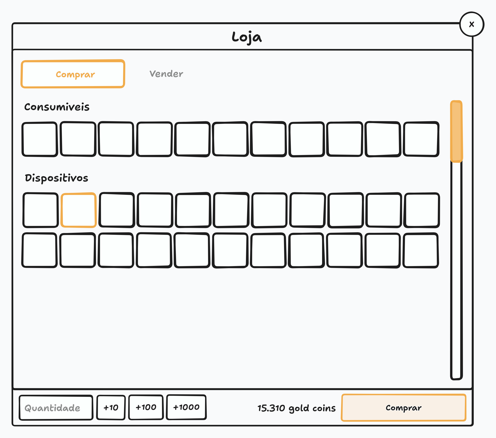
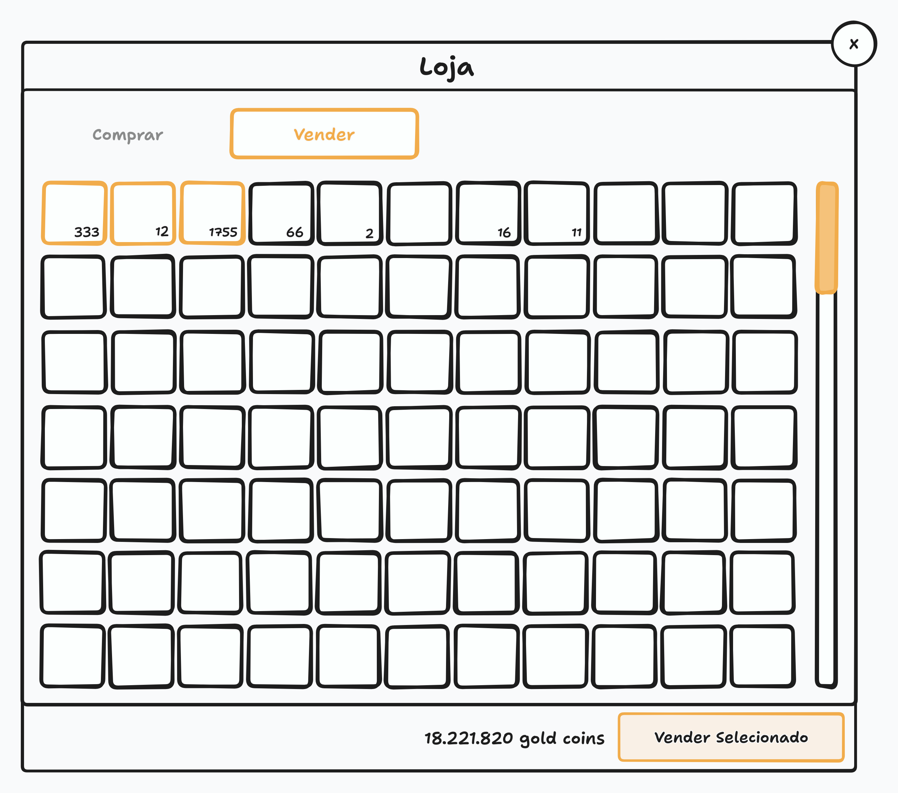

# Loja

Este documento cobre a loja da cidade, o modal onde o jogador compra itens básicos e vende o loot de criaturas por gold coins.

> Este documento cobre **o modal da loja**. A moeda do jogo, as regras de drop e a cura da cidade estão em [Cidade](CITY.md), e os itens do treinador e a mochila estão em [Mochila](BACKPACK.md).

## Visão Geral

A loja é um modal da [cidade](CITY.md#lojas). Compra e venda acontecem no mesmo modal, dividido em duas abas: **Comprar**, que vem ativa por padrão, e **Vender**, que o jogador abre com um clique na aba.

O modal segue o layout dos outros modais: título no topo, botão de fechar no canto superior direito e rodapé com as ações. O conteúdo e o rodapé mudam conforme a aba ativa.

O modal é acessado pelo NPC da loja e pelo [botão da loja](PLAY_SCREEN.md#botão-da-loja), que flutua logo acima da barra de habilidades e só existe na cidade.

> A loja não pausa o jogo. A simulação continua rodando com ela aberta, conforme a regra da [tela do jogo](PLAY_SCREEN.md): nenhum elemento da tela, inclusive os modais abertos a partir dela, pausa ou bloqueia o jogo.

## Mockup

> O mockup é ilustrativo e mostra a disposição geral, não o design final. Ele serve para conferir a estrutura da tela, não cores, tipografia ou espaçamento.

O primeiro mockup mostra a aba de compra, com a aba Comprar ativa, as seções Consumíveis e Dispositivos, e o rodapé com o campo de quantidade, os botões de soma, o total em gold coins e o botão Comprar. O segundo mostra a aba de venda, com a grade de itens da mochila, itens selecionados em destaque, e o rodapé com o campo de quantidade, os botões de soma, o total em gold coins e o botão Vender Selecionado.

## Preços

Todo item tem um valor, definido no banco de dados, e os números em si não são regra de jogo. A compra cobra o valor cheio do item, e a venda sempre rende 90% do valor: um item comprado por 100 é vendido por 90.

> Os 10% de diferença são o custo de passar pela loja. O jogador que compra por impulso perde um pouco ao devolver, e a loja continua sendo o destino natural do loot — que ele não pagou nada para ter.

## Aba de Compra

A aba de compra lista o que a loja vende, em duas categorias, cada uma com o seu título: **Consumíveis** e **Dispositivos**.

Ao passar o cursor sobre um item, o [popup](INTERFACE.md#popup) exibe o nome do item e o seu valor de compra em gold coins.

A grade é a mesma da [mochila](BACKPACK.md#slots-de-itens), com as mesmas regras: fileiras completas, espaços vazios preenchidos com slots vazios e nenhum número fixo de colunas. O catálogo da loja ocupa o começo da grade, e o resto do espaço fica com slots vazios.

### Seleção e Quantidade

Para comprar, o jogador clica em um item, que entra no estado **selecionado**, destacado na grade. A seleção é a marca da escolha: ela fica no slot clicado, não some quando o cursor sai e troca quando o jogador clica em outro item. Sem item selecionado, o campo de quantidade do rodapé fica desabilitado. Ao selecionar um item, o campo é habilitado já com o valor 1.

A quantidade nunca pode ser 0 nem vazia: se o jogador apagar o campo, digitar um valor negativo ou deixá-lo em branco, ao tirar o foco do campo o valor volta a ser 1.

Do lado do campo existem três botões, **+10**, **+100** e **+1000**, que somam o valor do botão à quantidade atual: com 1 no campo, o +10 leva a 11, e mais um clique leva a 21. A quantidade máxima é **999999**, seis dígitos, e quem quiser comprar mais do que isso aperta Comprar mais vezes. Os botões de soma travam nesse limite: com 999500 no campo, o +1000 leva a 999999, e não além.

> Os botões existem para o jogador não digitar quantidades grandes à mão, e a soma incide sobre o que já está no campo: um clique a mais nunca significa começar de novo.

### Total e Compra

Do lado esquerdo do botão **Comprar** fica o total de gold coins da compra, que atualiza em tempo real: um item de 5 gold coins com quantidade 1 mostra 5, e ao clicar em +10 a quantidade vai a 11 e o total a 55. Sem nada selecionado, o total fica em 0.

Sem dinheiro suficiente, o botão **Comprar** fica desabilitado, com um tooltip dizendo "Você não tem dinheiro suficiente". Com dinheiro suficiente, ele fica habilitado. O saldo do jogador fica visível na [toolbar](PLAY_SCREEN.md#menu-da-direita), e é ele que decide se o botão fica habilitado.

A compra não tem confirmação: o clique executa a compra. Os itens vão direto para a [mochila](BACKPACK.md), o gold coin é subtraído, o item sai do estado selecionado e o modal volta ao estado original — sem seleção, campo de quantidade desabilitado e total zerado.

> Sem confirmação porque o total exato está na tela antes do clique, e comprar é a ação mais comum da loja. O arrependimento tem caminho: o item comprado pode ser vendido de novo na aba de venda.

## Aba de Venda

A aba de venda lista todos os itens da [mochila](BACKPACK.md) do treinador — dispositivos, poções e itens de criaturas, ou seja, tudo o que a loja vende mais o drop. Itens iguais ficam em um slot só, com a quantidade na label: 300 poções de cura ocupam um slot com 300, e não 300 slots.

Ao passar o cursor sobre um item, o [popup](INTERFACE.md#popup) exibe o nome do item e o seu valor de venda em gold coins — o valor **unitário** do item, o de uma unidade.

As duas abas usam a mesma grade, com as mesmas regras de preenchimento de espaços vazios.

> A aba de venda pode ter poucos itens — um jogador com três itens veria três slots e um vazio gigante sem o preenchimento. A regra é a mesma da [mochila](BACKPACK.md#slots-de-itens) e vale nas duas abas.

### Venda

Para vender, o jogador clica em um item, que entra no estado **selecionado**, destacado na grade. A seleção é a marca da escolha: ela fica no slot clicado, não some quando o cursor sai e troca quando o jogador clica em outro item.

O rodapé da aba de venda é o mesmo da aba de compra: à esquerda ficam o campo de quantidade e os botões de soma, e à direita o total em gold coins e o botão **Vender Selecionado**. Sem item selecionado, o campo de quantidade fica desabilitado e o botão também.

A quantidade tem as mesmas regras da compra: nunca é 0 nem vazia — se o jogador apagar o campo, digitar um valor negativo ou deixá-lo em branco, ao tirar o foco o valor volta a ser 1 —, o máximo é **999999**, e os botões **+10**, **+100** e **+1000** somam ao valor atual e travam nesse limite.

O **preço do item é o preço unitário**: é o que o [popup](INTERFACE.md#popup) mostra, ao lado do nome do item, e é com ele que o jogador multiplica. O **total** que fica do lado do botão é o valor da quantidade escolhida — o valor unitário vezes a quantidade — e não o valor de tudo o que está selecionado. Um item de 90 gold coins com quantidade 3 mostra 270 no total.

A venda não tem confirmação: o clique executa. Os itens vendidos saem da mochila, o gold coin é somado, o total do rodapé passa a ser o total que o servidor devolveu, e a seleção continua no item enquanto ele estiver na mochila: o jogador pode vender mais dele sem selecionar de novo. O item que sai da mochila por inteiro leva a seleção com ele, porque o slot dele não existe mais.

Vender mais do que o treinador tem na mochila é recusado pelo servidor, e a aba mostra o motivo da recusa, sem perder os itens que ainda estão na mochila.

## Comportamento

O modal não pausa o jogo. A simulação continua rodando com ele aberto.

> Isso não é uma escolha do modal e sim uma regra da [tela do jogo](PLAY_SCREEN.md): nenhum elemento da tela, inclusive os modais abertos a partir dela, pausa ou bloqueia o jogo.

Se a conexão com o servidor cai enquanto o modal está aberto, o modal é fechado junto com o restante da tela.

> Isso acontece por consequência da regra de [conexão da tela do jogo](PLAY_SCREEN.md#estados-da-tela): ao perder a conexão, o cliente sai da tela do jogo e exibe a tela de conexão perdida. Ao restabelecer, os componentes da tela são montados de novo, e o modal abre fechado. Não é preciso nenhum tratamento específico para esse caso.

Fechar o modal ou trocar de aba reseta todo o estado: a seleção é desfeita, a quantidade e os totais voltam ao inicial, e a aba de compra é sempre a que vem ativa quando o modal abre.

## Escopo das Fases Alfa e Beta

Os pontos abaixo ainda estão em aberto ou são provisórios nesta fase e devem ser revistos conforme o jogo evolui:

- A loja vende apenas o básico: consumíveis e dispositivos.
- Compra e venda não têm confirmação: o clique executa a ação.
